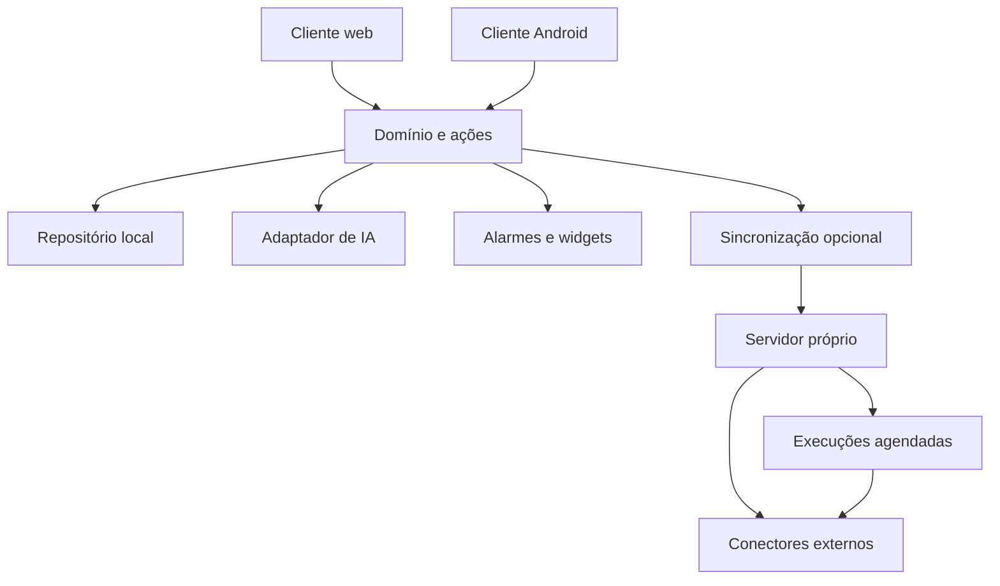

# Assistente pessoal gratuito e open source — especificação baseada no produto de referência

**Documento de partida para prototipação • versão 2.0 • 21/10/2026**  
**Referência analisada:** `ZIP de referência 2`, aplicativo Android `app.de.referencia`, versão `3.2`, código `7831`.

Este documento transforma a análise estática do aplicativo em um plano para criar uma implementação independente. O nome de trabalho é **Assistente Aberto**; nome, identidade visual e código do novo projeto serão próprios. A direção visual definida pelo usuário é minimalista, com um gato personalizável como assistente: pelagens como frajola e siamês, roupas e óculos combináveis. A especificação do mascote está na seção 17.

O catálogo descreve **256 capacidades identificáveis, distribuídas em 21 módulos**. Ele inclui funções básicas e avançadas, inclusive aquelas sujeitas a assinatura no aplicativo de referência. Um item identificado em código, texto ou estrutura de dados não equivale a uma função testada em execução. Recursos podem estar desativados, restritos a outra plataforma, condicionados a configuração remota ou incompletos.

## Como usar este documento

1. Ler as seções 1 a 4 para entender o produto e o primeiro recorte.
2. Usar o catálogo da seção 5 como mapa de funcionalidades e dependências.
3. Implementar o recorte P0 das seções 11 e 12 antes de avançar para integrações.
4. Entregar a seção 15 ao agente de desenvolvimento como instrução inicial.
5. Manter o estado de cada recurso atualizado em um backlog do novo projeto; as etapas abaixo são propostas, não cronograma acordado.

**Leitura rápida:** é possível começar com chat, agenda, tarefas, armazenamento local e um assistente simulado para demonstração. Uma versão Android com alarmes e widgets exige trabalho nativo. IA, coordenação por e-mail, páginas públicas, pesquisa externa e automações em servidor precisam de implementações próprias e serviços configurados.

## 1. O que é possível construir a partir da análise

| Entrega | O que a referência permite orientar | O que precisa ser criado |
| --- | --- | --- |
| Especificação funcional | Módulos, ações, campos, estados e integrações identificáveis | Critérios de produto e validação de comportamento |
| Protótipo navegável | Fluxos de conversa, agenda, afazeres, memória e configurações | Interface e identidade visual próprias |
| Aplicativo funcional | Separação de responsabilidades e requisitos de integração | Código-fonte novo, banco, notificações e tratamento de falhas |
| Assistente de IA | Entradas, ferramentas e tipos de resposta esperados | Orquestração, prompts próprios, provedor e avaliação de qualidade |
| Serviço auto-hospedável | Necessidade de sincronização, workers e conectores | Servidor, autenticação, implantação e manutenção |
| Integrações | Provedores citados e finalidade apresentada pela interface | Credenciais próprias, autorização e adaptadores |
| Aplicativo totalmente offline | Dados e ações locais; possibilidade de IA local configurável | Runtime e modelo compatíveis com a máquina; verificação de desempenho |

Não foram recuperados os servidores do produto de referência, seus prompts internos, modelos, credenciais de usuário, configuração de produção completa ou código-fonte original. O arquivo contém material compilado e recursos do cliente.

## 2. Evidências, escopo e confiança

### 2.1 Resultado técnico da inspeção

| Item | Resultado |
| --- | --- |
| Arquivos no ZIP | 2.546 |
| Conteúdo descompactado | 58.487.744 bytes, aproximadamente 58,5 MB |
| Pacote e versão | `app.de.referencia`, `3.2`, build `7831` |
| Plataforma mínima declarada | Android API 26 |
| Código Android | Cinco arquivos DEX, com verificações internas de integridade válidas |
| Bundle principal | `assets/index.android.bundle`, 17.253.688 bytes |
| Formato do bundle | Bytecode Hermes, versão 98 |
| Tabela de strings do bundle | 98.949 entradas decodificadas; isso não significa 98.949 funcionalidades |
| Recursos referenciados pela tabela do pacote base | 1.613 caminhos, todos encontrados |
| Instalação completa | Não incluída: manifesto exige splits de arquitetura e densidade |
| Bibliotecas nativas `.so` | Ausentes neste ZIP |
| Modelo local de IA | Nenhum arquivo de modelo identificado pelos formatos examinados |
| Execução do aplicativo | Não executado pelo assistente; 18 prints e uma gravação de aproximadamente 7,2 s enviados pelo usuário foram inspecionados |

### 2.2 Como ler as referências do catálogo

| Prefixo | Significado | Exemplo de localização |
| --- | --- | --- |
| `R:` | Nome de recurso de texto na tabela Android | `R:settings_language` |
| `H:` | Entrada na tabela de strings do bundle Hermes | `H:chat.sessions.pin` |
| `C:` | Nome ou parte identificável de classe no DEX | `C:EventEntity` |
| `D:` | String identificada no DEX | Caminho, ação ou identificador técnico |
| `A:` | Arquivo existente dentro do pacote | `A:assets/assistant_voice_options_pt.json` |
| `M:` | Declaração no manifesto Android | Intent, permissão ou componente |
| `V:` | Tela inspecionada em screenshot fornecido pelo usuário | Nome do arquivo de imagem |

As referências são localizadores para auditoria da análise, não trechos a copiar para o novo produto. Elas foram verificadas contra os arquivos extraídos. Caminhos de API listados como evidência não foram chamados.

**Confiança O:** há evidência direta no pacote da capacidade ou da interface descrita; operação real ainda não foi validada.  
**Confiança V:** a tela ou opção foi vista nos prints; não implica execução bem-sucedida da função remota.  
**Confiança I:** o alcance foi inferido de referências parciais, estruturas, demonstrações ou material de outra plataforma.  
**Proposta:** desenho escolhido para a nova implementação; não representa descoberta sobre o original.

A ausência de um elemento no ZIP também não prova que o produto inteiro não o possua. Bibliotecas externas e textos de diagnóstico não devem ser promovidos automaticamente a funcionalidades do produto de referência. Em particular, não há confirmação de uma integração MCP configurável pelo usuário apenas porque o bundle contém referências de telemetria de MCP.

## 3. Diretrizes para a versão gratuita e open source

1. **Núcleo utilizável sem conta:** agenda, tarefas, pesquisa local, configurações e exportação não exigem servidor.
2. **Sem assinatura obrigatória:** capacidades implementadas no projeto não ficam atrás de um plano comercial do próprio aplicativo.
3. **Infraestrutura opcional:** sincronização e automações remotas usam um servidor próprio ou auto-hospedado.
4. **IA substituível:** permitir modo de demonstração, provedor remoto configurado pelo usuário e, futuramente, um runtime local compatível.
5. **Custo de operação visível:** software gratuito não elimina custo de computação, armazenamento, modelos ou serviços externos. Nenhuma gratuidade ilimitada de terceiros é presumida.
6. **Identidade própria:** escrever código novo, textos novos, ícones próprios ou de origem compatível e elementos visuais novos. Este documento não redistribui binários, logotipos, áudio ou chaves extraídos do aplicativo.
7. **Dados portáveis:** oferecer backup legível e exportação de agenda; o formato deve ser versionado.
8. **Funcionalidades essenciais determinísticas:** criar, editar, concluir, buscar e lembrar não dependem de o modelo de linguagem conseguir responder.
9. **Integrações desacopladas:** cada provedor pode ser habilitado ou removido sem quebrar o uso local.
10. **Estado verdadeiro na interface:** distinguir dado real, demonstração, integração desconectada, processamento pendente e falha.

### Modos de operação propostos

| Modo | O que funciona | O que precisa ser configurado |
| --- | --- | --- |
| Local básico | Agenda, afazeres, notas, busca e backup | Nenhuma conta ou chave |
| Demonstração | Fluxos de chat com respostas e propostas reproduzíveis | Dados fictícios e indicação de simulação |
| IA local | Interpretação e respostas no computador ou aparelho | Runtime, modelo e recursos compatíveis; opcional |
| IA remota | Interpretação e respostas de serviço escolhido | Endpoint, credencial própria e limite de uso |
| Sincronização própria | Dados compartilhados entre dispositivos autorizados | Servidor e autenticação próprios |
| Automação contínua | Verificações e integrações com o aplicativo fechado | Worker remoto ou processo local que continue em execução |

## 4. Etapas e recorte inicial

As etiquetas de etapa indicam uma ordem recomendada, não a afirmação de que todos os itens daquela etapa devem sair juntos.

| Etapa | Objetivo | Marco verificável |
| --- | --- | --- |
| P0 — protótipo local | Validar a experiência central sem dependências externas | Criar compromisso pelo chat, revisar, salvar, visualizar na agenda e concluir uma tarefa |
| P1 — produto local confiável | Expandir edição, recorrência, memória, backup e suporte Android | Dados persistem; alarmes locais são testados em dispositivo; fluxo manual completo |
| P2 — sincronização e integrações selecionadas | Conectar um calendário, sincronizar mudanças e ampliar produtividade | Uma integração real ponta a ponta, com reconexão e tratamento de conflito |
| P3 — assistente proativo e colaboração | Workers, condições, e-mail, agendamento público e coordenação | Uma automação e uma reserva reais, com histórico e resultados verificáveis |

### Primeiro protótipo recomendado

- Navegação proposta: **Chat, Agora, Agenda, Ações e Eu**.
- Conta local com nome e gato personalizável. No P0, oferecer seis pelagens, três roupas e três opções de óculos, incluindo alternativas sem acessórios.
- Agenda contém Calendário e Afazeres; Ações contém Coordenação e Automações, identificadas como planejadas no P0.
- Formulários completos para eventos e afazeres simples.
- Lista de agenda e visualização diária por horário.
- Chat em modo de demonstração por padrão; provedor real é extensão configurável.
- Proposta estruturada de ação antes de salvar o que foi extraído do texto.
- Persistência local e opção de exportar/importar um backup simples já no protótipo.
- Interface responsiva em português, com tema claro/escuro e rótulos acessíveis.

As demais capacidades aparecem no catálogo para orientar evolução. O objetivo inicial não é implementar 252 itens na primeira entrega.

## 5. Catálogo dos recursos identificados

**Dependências:** `L` = lógica/armazenamento local; `N` = integração nativa com o sistema; `A` = interpretação ou geração por IA; `V` = áudio, reconhecimento ou síntese de voz; `S` = servidor próprio; `X` = serviço ou conta externa. A dependência descrita se refere à implementação proposta e ao alcance da capacidade, não a uma reconstrução completa da arquitetura interna do original. IA e voz podem ser locais ou remotas conforme o adaptador escolhido.

### Resumo do catálogo

| Módulo | Capacidades |
| --- | --- |
| Acesso, perfil e introdução | 12 |
| Identidade e personalização do assistente | 13 |
| Chat, histórico e contexto | 20 |
| Imagens, arquivos e voz | 11 |
| Memórias, hábitos e preferências | 10 |
| Agenda, visualizações e busca | 15 |
| Eventos e recorrência | 15 |
| Afazeres, listas e subtarefas | 17 |
| Lembretes e confiabilidade no Android | 11 |
| Contatos e participantes | 10 |
| Convites e coordenação de reuniões | 12 |
| Páginas e links de agendamento | 18 |
| Inbox de sugestões e notificações | 10 |
| Triggers e tarefas proativas | 14 |
| Acompanhamento inteligente da agenda | 11 |
| Integrações de agenda, trabalho e mensagens | 16 |
| E-mail e endereço do assistente | 7 |
| Resumos e análise de uso do tempo | 5 |
| Widgets e integração com o sistema | 8 |
| Persistência, sincronização e recuperação | 10 |
| Preferências, acessibilidade e suporte | 11 |
| **Total** | **256** |

As capacidades são unidades de planejamento e podem compartilhar uma mesma tela ou implementação. A contagem não é uma lista oficial publicada pelo produto de referência.

### 5.1. Acesso, perfil e introdução

| ID | Recurso e comportamento a implementar | Confiança | Evidência | Dependências | Etapa |
| --- | --- | --- | --- | --- | --- |
| ACC01 | **Introdução guiada.** Apresentar agenda, tarefas, hábitos e coordenação com exemplos interativos. | O | `H:appOnboarding.taskCenter.empty.title` | L | P1 |
| ACC02 | **Identificação do usuário.** Cadastrar nome, e-mail e identificador público. | O | `H:appOnboarding.information.username` | L/S | P1 |
| ACC03 | **Entrada por e-mail.** Solicitar e validar código enviado ao e-mail, com reenvio e contagem de espera. | O | `R:account_setting_email_resend_countdown` | S/X | P2 |
| ACC04 | **Entrada com Google.** Conectar identidade Google para autenticação. | O | `R:continue_with_google` | S/X | P2 |
| ACC05 | **Identidade Apple.** Vincular conta Apple como método de acesso; validar disponibilidade por plataforma. | O | `R:account_setting_apple` | S/X | P3 |
| ACC06 | **Métodos de acesso vinculados.** Listar, conectar e desconectar identidades, preservando um meio de acesso. | O | `R:account_setting_unlink_disabled` | S | P2 |
| ACC07 | **Troca de e-mail.** Atualizar endereço com verificação. | O | `R:account_setting_update_email` | S/X | P2 |
| ACC08 | **Conflitos de identidade.** Orientar acesso à conta existente quando um endereço já estiver associado. | O | `R:existing_account_conflict_title` | S | P2 |
| ACC09 | **Migração de contas.** Oferecer fluxo explícito para combinar dados de contas relacionadas. | I | `R:account_setting_migrate_description2` | S | P3 |
| ACC10 | **Perfil público.** Editar nome apresentado a outras pessoas. | O | `R:edit_profile_public_name_label` | L/S | P1 |
| ACC11 | **Saída e exclusão da conta.** Encerrar sessão e excluir dados da conta mediante confirmação. | O | `R:account_delete_description` | L/S | P2 |
| ACC12 | **Faixa etária na introdução.** Há seleção de faixa etária no original; definir a política do novo produto separadamente. | I | `R:age_gate_title` | L | P3 |

### 5.2. Identidade e personalização do assistente

| ID | Recurso e comportamento a implementar | Confiança | Evidência | Dependências | Etapa |
| --- | --- | --- | --- | --- | --- |
| AST01 | **Nome do assistente.** Definir nome personalizado e validá-lo. | V | `H:myAssistant.nameLabel`; `V:Screenshot_20261021_100939_referencia.png` | L | P0 |
| AST02 | **Aparência do assistente.** Escolher representação visual própria, sem reaproveitar a identidade do original. | V | `H:appOnboarding.assistant.randomize`; `V:Screenshot_20261021_100939_referencia.png` | L | P1 |
| AST03 | **Personalidade por instruções.** Editar o estilo de interação e as instruções pessoais do assistente. | V | `H:myAssistant.personalityRowLabel`; `V:Screenshot_20261021_100939_referencia.png` | L/A | P1 |
| AST04 | **Personalidades predefinidas.** Selecionar estilos de personalidade oferecidos pelo produto. | O | `H:/referencia/user/assistant_soul_presets` | L/A | P1 |
| AST05 | **Prévia de escrita.** Testar o tom do assistente antes de salvar. | O | `H:myAssistant.personalityV2.writingPreview` | A | P1 |
| AST06 | **Estilo e tom de voz.** Selecionar estilos de voz, com alternativas de timbre. | O | `H:myAssistant.personalityV2.voiceStyle` | V | P2 |
| AST07 | **Seis estilos em português.** Oferecer equivalentes próprios para estilos acolhedor, brincalhão, profissional, direto, confiante e amigável. | O | `A:assets/assistant_voice_options_pt.json` | L/V | P2 |
| AST08 | **Reprodução automática.** Controlar leitura automática das respostas em texto. | V | `H:myAssistant.autoplayTextLabel`; `V:Screenshot_20261021_100939_referencia.png` | L/V | P2 |
| AST09 | **Notificações do assistente.** Ativar ou desativar avisos proativos do assistente. | O | `H:myAssistant.notificationLabel` | L/N/S | P1 |
| AST10 | **Quem pode conversar com o assistente.** Configurar acesso público, contatos, usuários do serviço ou ninguém. | O | `H:myAssistant.accessLevel.contacts` | S | P3 |
| AST11 | **Nome de remetente.** Definir como o assistente se identifica em comunicações externas. | V | `H:myAssistant.senderName.title`; `V:Screenshot_20261021_100939_referencia.png` | S/X | P3 |
| AST12 | **Endereço do assistente.** Reservar endereço de e-mail e identificador em domínio próprio do novo serviço. | O | `H:myAssistant.assistantAddressClaim` | S/X | P3 |
| AST13 | **Como o assistente chama o usuário.** Configurar um apelido privado usado pelo assistente. | V | `H:memorias.nicknameLabel`; `V:Screenshot_20261021_100939_referencia.png` | L | P1 |

### 5.3. Chat, histórico e contexto

| ID | Recurso e comportamento a implementar | Confiança | Evidência | Dependências | Etapa |
| --- | --- | --- | --- | --- | --- |
| CHT01 | **Conversa principal.** Trocar mensagens com o assistente e manter histórico persistente. | O | `H:chat.sessions.mainChat` | L/A | P0 |
| CHT02 | **Criar evento pelo chat.** Transformar solicitação em proposta estruturada de compromisso. | O | `H:chat.emptyState.createEvent` | L/A | P0 |
| CHT03 | **Criar tarefa pelo chat.** Criar afazer a partir de linguagem natural. | O | `H:chat.emptyState.addTodo` | L/A | P0 |
| CHT04 | **Múltiplas conversas.** Abrir e retomar sessões independentes. | V | `H:chat.sessions.openSessions`; `V:Screenshot_20261021_100946_referencia.png` | L | P1 |
| CHT05 | **Renomear conversa.** Alterar o nome de uma sessão. | O | `H:chat.sessions.rename` | L | P1 |
| CHT06 | **Fixar conversas.** Fixar e desafixar sessões para acesso rápido. | O | `H:chat.sessions.pin` | L | P1 |
| CHT07 | **Excluir conversa.** Remover uma sessão com confirmação. | O | `H:chat.sessions.deleteMessage` | L | P1 |
| CHT08 | **Responder a uma mensagem.** Enviar resposta com referência à mensagem original. | O | `H:chat.contextMenu.reply` | L/A | P1 |
| CHT09 | **Copiar e excluir mensagens.** Executar ações sobre mensagens individuais. | O | `H:chat.contextMenu.copy`; `H:chat.contextMenu.delete` | L | P1 |
| CHT10 | **Reenviar após falha.** Exibir falha de entrega e permitir nova tentativa sem duplicação. | O | `H:chat.accessibility.resendFailedMessage` | L/A/S | P0 |
| CHT11 | **Reações.** Adicionar ou alterar reação em mensagens e itens de agenda. | O | `H:chat.accessibility.addReaction` | L | P1 |
| CHT12 | **Cartões interativos.** Exibir eventos, listas, sugestões e confirmações como componentes acionáveis. | V | `C:InteractionBlockData`; `C:ConfirmationBlock`; `V:Screenshot_20261021_100950_referencia.png` | L/A | P0 |
| CHT13 | **Contexto de contatos e agenda.** Selecionar contatos, calendários e eventos como contexto da conversa. | O | `H:chat.mention.contactsTitle`; `H:chat.mention.calendars` | L/A | P1 |
| CHT14 | **Contexto de tarefas e listas.** Referenciar afazeres e listas em uma solicitação. | O | `H:chat.mention.seedLists`; `H:chat.mention.todos` | L/A | P1 |
| CHT15 | **Pesquisa na web.** Acionar ferramenta de pesquisa a partir da conversa. | O | `H:chat.mention.webSearch` | A/X | P3 |
| CHT16 | **Ferramentas pelo compositor.** Iniciar coordenação ou automação a partir do menu de anexos. | O | `H:chat.attachmentSheet.coordination`; `H:chat.attachmentSheet.triggerDesc` | L/A/S | P3 |
| CHT17 | **Histórico expandido.** Mostrar ou recolher histórico e navegar para mensagens recentes. | O | `H:chat.history.show`; `H:chat.accessibility.jumpToLatestMessages` | L | P1 |
| CHT18 | **Limpar histórico.** Oferecer limpeza explícita das conversas. | O | `H:/referencia/chat/clear-history` | L/S | P1 |
| CHT19 | **Escolha do modo de resposta.** Há seleção automática e de versão do assistente; a nova versão pode mapear para perfis próprios. | I | `H:chat.versionSelect.auto.label` | L/A | P2 |
| CHT20 | **Reportar resposta.** Enviar feedback sobre uma mensagem específica. | O | `H:chat.contextMenu.report` | L/S | P2 |

### 5.4. Imagens, arquivos e voz

| ID | Recurso e comportamento a implementar | Confiança | Evidência | Dependências | Etapa |
| --- | --- | --- | --- | --- | --- |
| INP01 | **Enviar imagens.** Anexar uma ou mais imagens e uma legenda ao chat. | O | `H:chat.input.captionPlaceholder`; `H:chat.accessibility.selectedImagePreview` | L/A | P1 |
| INP02 | **Anexos de arquivo.** Representar anexos de arquivo na conversa; validar formatos aceitos em execução. | I | `H:chat.collapsedAttachmentTag.file` | L/A | P2 |
| INP03 | **Recortar imagem.** Recortar, reposicionar e restaurar imagem antes do envio. | O | `H:chat.imageCrop.editImage`; `H:chat.imageCrop.reset` | L | P2 |
| INP04 | **Visualizador de imagens.** Ampliar, salvar e compartilhar imagens recebidas. | O | `H:chat.accessibility.saveImage`; `H:chat.accessibility.shareImage` | L/N | P2 |
| INP05 | **Extrair evento de imagem.** Interpretar imagem como entrada para criação de eventos; não foi validada a qualidade da extração. | I | `R:compare_creating_events_v1` | A | P2 |
| INP06 | **Mensagem de voz.** Gravar, cancelar e enviar áudio. | O | `H:voice.slideToCancel`; `H:chat.accessibility.sendVoiceRecording` | L/V | P1 |
| INP07 | **Voz para texto.** Transcrever gravação e permitir revisão do texto. | O | `H:chat.accessibility.recordVoiceToText`; `H:/referencia/speech/transcribe` | V | P1 |
| INP08 | **Ler mensagens em voz alta.** Sintetizar e reproduzir o texto de uma resposta. | O | `H:chat.contextMenu.playVoice` | V | P2 |
| INP09 | **Conversa de voz em tempo real.** Exibir estados ouvindo, falando e processando durante sessão de voz. | I | `H:calendar.realtime.listening`; `H:calendar.realtime.speaking` | V/A/S | P3 |
| INP10 | **Controles de chamada.** Atender, recusar, encerrar, silenciar microfone e alternar alto-falante. | O | `R:call_answer`; `R:call_mute`; `R:call_speaker_on` | N/V/S/X | P3 |
| INP11 | **Tratamento de permissão e erro de áudio.** Orientar quando microfone estiver negado, gravação for curta ou transcrição falhar. | O | `H:voice.micPermissionDenied`; `H:voice.tooShort` | L/N/V | P1 |

### 5.5. Memórias, hábitos e preferências

| ID | Recurso e comportamento a implementar | Confiança | Evidência | Dependências | Etapa |
| --- | --- | --- | --- | --- | --- |
| MEM01 | **Catálogo de memórias.** Listar informações que o assistente guarda sobre a pessoa. | V | `H:memorias.navTitle`; `V:Screenshot_20261021_101054_referencia.png` | L | P1 |
| MEM02 | **Criar memória manualmente.** Adicionar título, descrição e categoria. | V | `H:memorias.createModalTitle`; `H:memorias.detailsTitle`; `V:Screenshot_20261021_101054_referencia.png` | L | P1 |
| MEM03 | **Editar e excluir memória.** Alterar ou remover qualquer memória visível. | O | `H:memorias.editModalTitle`; `H:memorias.deleteConfirmTitle` | L | P1 |
| MEM04 | **Categorias de memória.** Organizar identidade, fatos, preferências, relações, restrições, regras e habilidades. | O | `H:memorias.categories.constraint`; `H:memorias.categories.skill` | L | P1 |
| MEM05 | **Filtrar memórias.** Filtrar por categoria e apresentar estados vazios. | O | `H:memorias.filters.menuLabel` | L | P1 |
| MEM06 | **Criar memória por conversa.** Solicitar ao assistente que registre uma informação. | O | `H:memorias.chatCreatePrompt` | L/A | P1 |
| MEM07 | **Aprendizagem a partir do uso.** Há apresentação de aprendizagem de preferências; algoritmo e critérios não estão recuperados. | I | `H:memorias.learnMoreDialog.learnsTitle` | A | P2 |
| MEM08 | **Importação de memória.** Existe fluxo ou guia de importação; formatos e provedores precisam ser validados. | V | `H:memorias.importAction`; `V:Screenshot_20261021_101054_referencia.png` | L/A | P2 |
| MEM09 | **Preferências de rotina.** Coletar ritmo diário, antecedência preferida e tipo de lembrete. | I | `H:appOnboarding.rememberHabits.naturalRhythm.title` | L/A | P1 |
| MEM10 | **Ativar ou desativar memória.** Controlar o uso de memória nas conversas e abrir suas configurações. | V | `H:memory_enabled`; `V:Screenshot_20261021_101051_referencia.png` | L/A | P1 |

### 5.6. Agenda, visualizações e busca

| ID | Recurso e comportamento a implementar | Confiança | Evidência | Dependências | Etapa |
| --- | --- | --- | --- | --- | --- |
| CAL01 | **Agenda do dia.** Mostrar compromissos e próximos itens na tela inicial. | V | `H:home.now.viewCalendar`; `H:home.now.noEvents`; `V:Screenshot_20261021_100954_referencia.png` | L | P0 |
| CAL02 | **Linha do tempo diária.** Exibir blocos de eventos posicionados por horário. | O | `H:DayViewHourGrid`; `H:DayViewEventBlock` | L | P0 |
| CAL03 | **Alternar lista e linha do tempo.** Escolher representação diária por lista ou grade horária. | O | `H:calendar.dayDisplayMode.switchToList`; `H:calendar.dayDisplayMode.switchToTimeline` | L | P1 |
| CAL04 | **Navegar por datas.** Ir para hoje e percorrer dias, semanas e meses; detalhes de todos os modos exigem validação visual. | V | `H:calendar.today`; `C:CalendarZoomInteractionSource`; `V:Screenshot_20261021_100958_referencia.png` | L | P0 |
| CAL05 | **Ajuste de escala.** Controlar a escala de visualização da agenda. | I | `H:calendar.zoomControls.adjust` | L | P2 |
| CAL06 | **Busca na agenda.** Pesquisar eventos e tarefas, com estados de início, erro e ausência de resultados. | O | `H:home.calendar.search.placeholder` | L | P1 |
| CAL07 | **Filtros de busca.** Filtrar por espécie do item e estado de conclusão. | O | `H:home.calendar.search.filters.kinds.`; `H:home.calendar.search.status.completed` | L | P1 |
| CAL08 | **Calendários visíveis.** Selecionar calendários exibidos e um calendário padrão. | V | `R:calendar_settings_calendar_checkbox`; `R:calendar_settings_default_calendar`; `V:Screenshot_20261021_101016_referencia.png` | L | P0 |
| CAL09 | **Nome e cor do calendário.** Criar, renomear, colorir e excluir calendários próprios. | O | `R:calendar_settings_new_calendar`; `R:calendar_settings_calendar_color` | L | P1 |
| CAL10 | **Categorias e cores de eventos.** Configurar classificação visual por categoria. | V | `H:calendar.viewOptions.category`; `H:/referencia/user/event_category_color_config`; `V:Screenshot_20261021_101051_referencia.png` | L/A | P1 |
| CAL11 | **Ocultar duplicatas e recusados.** Controlar duplicação aparente e exibição de convites recusados. | V | `H:calendar.viewOptions.hideDuplicateEvents`; `H:calendar.viewOptions.showDeclinedEvents`; `V:Screenshot_20261021_101016_referencia.png` | L | P2 |
| CAL12 | **Emojis e reações na agenda.** Controlar exibição de emojis e filtrar estados ou reações. | V | `H:calendar.viewOptions.showEventEmoji`; `H:calendar.viewOptions.reactions.completed`; `V:Screenshot_20261021_101016_referencia.png` | L | P2 |
| CAL13 | **Reposicionar eventos.** Arrastar eventos para outro horário, respeitando origem e permissão de edição. | O | `H:DayViewDragGhost`; `H:event.moveUnavailable` | L | P2 |
| CAL14 | **Calendários somente leitura.** Indicar origem e impedir edição de eventos sem permissão. | O | `R:calendar_readonly_event_message` | L/X | P1 |
| CAL15 | **Catálogo de calendários assináveis.** Pesquisar e assinar calendários temáticos de um catálogo. | O | `H:calendar.subscriptions.searchPlaceholder`; `H:/referencia/ical-feed-catalog` | S/X | P3 |

### 5.7. Eventos e recorrência

| ID | Recurso e comportamento a implementar | Confiança | Evidência | Dependências | Etapa |
| --- | --- | --- | --- | --- | --- |
| EVT01 | **Criar e editar evento.** Gerenciar título, início, fim, calendário e demais atributos. | O | `R:event_edit_title_new`; `H:event.dateTimeEdit.title` | L | P0 |
| EVT02 | **Dia inteiro e vários dias.** Representar eventos sem hora e compromissos que atravessam datas. | O | `H:event.allDay`; `H:event.multiDayLabel` | L | P0 |
| EVT03 | **Localização do evento.** Buscar local, editar endereço e abrir em aplicativo de mapas. | O | `H:event.locationPopover.edit`; `H:event.locationPopover.findInMaps` | L/X | P1 |
| EVT04 | **Notas e checklist no evento.** Adicionar texto ou lista de verificação às notas. | O | `H:event.notes.modeChecklist`; `H:event.notes.modeText` | L | P1 |
| EVT05 | **Participantes.** Adicionar e remover convidados do evento. | O | `H:event.actionMenu.addAttendees`; `C:Attendees` | L/S/X | P2 |
| EVT06 | **Anexos do evento.** Representar e baixar anexos associados ao compromisso. | O | `H:event.attachments.downloadPromptMessage`; `C:EventAttachment` | L/S | P2 |
| EVT07 | **Repetição periódica.** Configurar recorrência diária, semanal, mensal ou anual e intervalos. | O | `C:RecurrenceRules`; `H:event.dateTimeEdit.repeat` | L | P1 |
| EVT08 | **Término da recorrência.** Definir término por data, contagem ou sem limite. | O | `H:event.dateTimeEdit.repeatCount`; `H:event.dateTimeEdit.endRepeatsOn` | L | P1 |
| EVT09 | **Editar ocorrência ou série.** Escolher somente esta, esta e próximas ou toda a série. | O | `H:event.recurringScopeOptions.onlyThisEvent`; `H:event.recurringScopeOptions.thisAndFollowingEvents` | L | P2 |
| EVT10 | **Excluir ocorrência ou série.** Aplicar escopo de exclusão aos eventos recorrentes. | O | `H:event.deleteModal.chooseRecurringScopeTitle` | L | P2 |
| EVT11 | **Múltiplos lembretes.** Configurar mais de um aviso antes ou depois do evento. | O | `H:event.alarm.additionalAlarms`; `H:event.alarm.hourAfter` | L/N | P1 |
| EVT12 | **Regras para dia inteiro.** Configurar avisos no dia, no anterior ou no seguinte. | O | `H:event.alarm.allDay.dayBefore`; `H:event.alarm.allDay.onTheDay` | L/N | P1 |
| EVT13 | **Conversa vinculada ao evento.** Pedir alterações em um chat contextual do compromisso. | O | `H:event.sheet.chatInputPlaceholder` | L/A | P1 |
| EVT14 | **Emoji do evento.** Escolher ou receber recomendação de emoji. | O | `H:event.emojiRecommend` | L/A | P2 |
| EVT15 | **Link de reunião.** Abrir chamada ou reunião a partir da agenda. | O | `H:home.now.joinMeeting`; `C:ConferenceInfo` | L/X | P1 |

### 5.8. Afazeres, listas e subtarefas

| ID | Recurso e comportamento a implementar | Confiança | Evidência | Dependências | Etapa |
| --- | --- | --- | --- | --- | --- |
| TSK01 | **Criar e editar afazer.** Gerenciar título e notas de uma tarefa independente de evento. | V | `H:seeds.newSeed`; `H:seeds.sheet.notesPlaceholder`; `V:Screenshot_20261021_101004_referencia.png` | L | P0 |
| TSK02 | **Concluir e reabrir.** Marcar conclusão, reabrir e desfazer ação recente. | O | `H:seeds.sheet.markCompleteAction`; `H:seeds.sheet.incompleteAction` | L | P0 |
| TSK03 | **Prazo e horário.** Definir data, hora ou prazo de dia inteiro. | O | `H:seeds.sheet.dueTimeTitle`; `H:seeds.sheet.allDayLabel` | L | P0 |
| TSK04 | **Listas próprias.** Criar, renomear, colorir, trocar e excluir listas. | O | `H:seeds.lists.createAction`; `H:seeds.lists.colorLabel` | L | P1 |
| TSK05 | **Mover entre listas.** Alterar a lista à qual o afazer pertence. | O | `H:seeds.sheet.changeListAction` | L | P1 |
| TSK06 | **Subtarefas.** Adicionar e gerenciar itens subordinados. | O | `H:seeds.sheet.addSubTodo` | L | P1 |
| TSK07 | **Importância.** Marcar nível de importância de uma tarefa. | O | `H:seeds.sheet.importanceAction` | L | P1 |
| TSK08 | **Ordenação.** Ordenar itens e persistir mudanças de posição. | O | `H:seeds.sort.action`; `H:seeds.sheet.reorderFailedToast` | L | P1 |
| TSK09 | **Notificações de prazo.** Programar avisos no vencimento ou depois dele. | O | `H:seeds.sheet.notificationAtDueTime`; `H:seeds.sheet.notificationDayAfterDue` | L/N | P1 |
| TSK10 | **Repetição após concluir.** Repetir após determinado número de horas, dias, semanas, meses ou anos da conclusão. | O | `H:seeds.sheet.repeatAfterCompletionDay`; `H:seeds.sheet.repeatAfterCompletionMonth` | L | P2 |
| TSK11 | **Histórico de conclusões.** Consultar quando as ocorrências de uma tarefa foram concluídas. | O | `H:seeds.sheet.completionHistoryTitle` | L | P2 |
| TSK12 | **Recorrência e série de subtarefas.** Aplicar edição e exclusão a séries de afazeres e subtarefas. | O | `H:seeds.sheet.occurrence.deleteSubTodoSeriesConfirmTitle` | L | P2 |
| TSK13 | **Sugestão de horário.** Pedir recomendação para encaixar um afazer na agenda. | O | `H:seeds.sheet.timeRecommendationAction` | L/A | P2 |
| TSK14 | **Converter em compromisso.** Transformar ou agendar um afazer como evento. | O | `H:seeds.sheet.convertingToEvent`; `H:seeds.sheet.scheduleSuccessToast` | L | P1 |
| TSK15 | **Discussão por tarefa.** Manter conversa ligada à tarefa ou ocorrência. | O | `H:seeds.sheet.threadPlaceholder` | L/A | P1 |
| TSK16 | **Limpeza de concluídas.** Remover afazeres concluídos em lote, mediante confirmação. | O | `H:seeds.sheet.deleteAllCompletedMessage` | L | P2 |
| TSK17 | **Listas compartilhadas.** Há indicação de listas compartilhadas; papéis e permissões ainda precisam ser validados. | I | `H:seeds.lists.shared` | S | P3 |

### 5.9. Lembretes e confiabilidade no Android

| ID | Recurso e comportamento a implementar | Confiança | Evidência | Dependências | Etapa |
| --- | --- | --- | --- | --- | --- |
| REM01 | **Lembretes locais.** Agendar notificações de evento sem depender de uma conexão ativa no momento do aviso. | O | `C:EventReminderReceiver`; `C:ReminderScheduleMethod` | L/N | P1 |
| REM02 | **Aviso local em tela de chamada.** Mostrar lembrete com aparência de chamada; separar isso de uma ligação telefônica real. | O | `C:LocalCallReminderActivity` | L/N/V | P2 |
| REM03 | **Fala de lembrete.** Gerar áudio de lembrete para eventos e tarefas, com alternativa local ou previamente armazenada. | O | `C:ReminderSpeechRequest`; `C:TodoReminderSpeechRequest` | L/V | P2 |
| REM04 | **Sons configuráveis.** Selecionar som para mensagem, evento e chamada. | O | `R:notification_settings_notification_sounds` | L/N | P1 |
| REM05 | **Preferências padrão.** Definir duração e padrões de aviso para eventos e eventos de dia inteiro. | O | `R:notification_settings_default_event_settings` | L | P1 |
| REM06 | **Diagnóstico de permissões.** Mostrar estado de notificações, alarmes exatos e avisos em tela cheia. | O | `R:permission_exact_alarm`; `R:permission_full_screen_notification` | N | P1 |
| REM07 | **Diagnóstico de bateria.** Explicar restrições de uso em segundo plano conforme o aparelho. | O | `R:background_activities_title`; `R:battery_optimization_title` | N | P2 |
| REM08 | **Recuperação após reinício.** Reconciliar lembretes após reiniciar aparelho ou atualizar agenda. | O | `C:LocalReminderRecoveryReceiver`; `C:ReminderRecoveryReason` | L/N | P1 |
| REM09 | **Lista de lembretes locais.** Permitir conferir avisos e chamadas locais programadas. | O | `R:local_reminders_list_title`; `R:local_call_list_title` | L/N | P2 |
| REM10 | **Atualização de alarmes.** Cancelar ou reagendar avisos quando item ou recorrência mudar. | O | `C:ReminderScheduleReason`; `C:ReminderRefreshMode` | L/N | P1 |
| REM11 | **Avisos por mensageiros.** Enviar avisos a canais de mensagens conectados, usando integrações próprias. | O | `R:notification_settings_im_messaging_notifications` | S/X | P3 |

### 5.10. Contatos e participantes

| ID | Recurso e comportamento a implementar | Confiança | Evidência | Dependências | Etapa |
| --- | --- | --- | --- | --- | --- |
| CON01 | **Cadastro e edição de contato.** Gerenciar nomes, apelido, e-mails, telefone e anotação. | O | `R:contact_nickname`; `R:contact_user_note_placeholder` | L | P1 |
| CON02 | **Aniversário e atributos opcionais.** Guardar aniversário e demais campos opcionais do perfil. | O | `R:contact_birthday`; `R:contact_gender` | L | P2 |
| CON03 | **Foto do contato.** Representar e visualizar avatar. | O | `R:contact_view_profile_photo`; `C:ContactAvatarResponse` | L | P2 |
| CON04 | **Busca de contatos.** Pesquisar pessoas pelo cadastro. | O | `R:contacts_search_placeholder` | L | P1 |
| CON05 | **Grupos de contatos.** Criar e excluir grupos de pessoas. | O | `R:contact_group_create`; `R:contact_group_delete_title` | L | P2 |
| CON06 | **Importação do aparelho.** Selecionar todos ou alguns contatos locais para importar. | V | `R:contacts_phone_picker_select_all`; `R:contacts_import_from_phone_action`; `V:Screenshot_20261021_101041_referencia.png` | N | P2 |
| CON07 | **Importação Google Contacts.** Autorizar conta Google, conferir prévia e importar contatos. | V | `R:contacts_import_from_google_action`; `C:GoogleContactsPreviewResponse`; `V:Screenshot_20261021_101041_referencia.png` | S/X | P2 |
| CON08 | **Validação de duplicados.** Detectar e-mail ou telefone já cadastrado. | O | `R:contact_email_already_exists`; `R:contact_phone_already_exists` | L | P1 |
| CON09 | **Sugestões e recentes.** Exibir pessoas sugeridas e recentemente contatadas. | O | `R:contacts_may_know_group_title`; `R:select_contacts_recently_contacted` | L/S | P2 |
| CON10 | **Convidar por endereço.** Permitir participante novo informado por e-mail sem cadastro prévio completo. | O | `R:select_contacts_search_placeholder` | L/S/X | P2 |

### 5.11. Convites e coordenação de reuniões

| ID | Recurso e comportamento a implementar | Confiança | Evidência | Dependências | Etapa |
| --- | --- | --- | --- | --- | --- |
| COL01 | **Enviar ou omitir e-mail de convite.** Salvar participantes escolhendo se a comunicação deve ser enviada. | O | `R:select_contacts_send_email_title`; `R:select_contacts_send_email_skip` | S/X | P2 |
| COL02 | **Responder a convite.** Aceitar, recusar ou responder talvez. | O | `H:event.invitation.accept`; `H:event.invitation.maybe`; `H:event.invitation.reject` | S/X | P2 |
| COL03 | **Resposta com mensagem.** Adicionar texto à resposta do convite. | O | `H:event.invitation.replyWithMessage` | S/X | P2 |
| COL04 | **Impacto do convite na agenda.** Mostrar conflitos e possíveis ajustes antes da confirmação. | O | `H:jsonRenderScheduleInvitation.viewCalendarImpact` | L/A | P2 |
| COL05 | **Sugestões de resolução de conflito.** Comparar antes e depois, sugerir mudança e confirmar ajustes. | O | `H:jsonRenderScheduleConflict.preview`; `H:jsonRenderScheduleConflict.confirmAdjustments` | L/A | P2 |
| COL06 | **Nova coordenação por e-mail.** Criar solicitação com participantes e objetivo em linguagem natural. | O | `H:kiwi.composer.requestPlaceholderMany`; `H:/referencia/kiwi/coordinations` | S/A/X | P3 |
| COL07 | **Gerenciar participantes da coordenação.** Adicionar e retirar pessoas e salvar novos contatos. | O | `H:kiwi.addParticipant.addEmail`; `H:kiwi.addToContacts.confirm` | S | P3 |
| COL08 | **Estados da coordenação.** Listar aguardando abordagem, aguardando resposta, aguardando confirmação e concluídas. | O | `H:kiwi.list.awaitingRepliesTab`; `H:kiwi.list.awaitingConfirmationTab` | S | P3 |
| COL09 | **Histórico de e-mails.** Exibir remetentes, destinatários, citações, anexos e convites de calendário. | O | `H:kiwi.email.showEarlierQuotedContent`; `H:kiwi.email.calendarInvite` | S/X | P3 |
| COL10 | **Conversa contextual da coordenação.** Pedir explicações ou mudanças sobre a negociação. | O | `H:kiwi.sheet.chatPlaceholder` | S/A | P3 |
| COL11 | **Pausar, retomar e encerrar.** Administrar ciclo de vida da coordenação e tratar estados somente leitura. | I | `H:kiwi.close.confirmTitle`; `H:kiwi.quota.resumeFailed` | S | P3 |
| COL12 | **Notas de coordenação.** Atualizar instruções e observações de uma negociação. | O | `H:kiwi.notes.title`; `H:kiwi.notes.updateHint` | S/A | P3 |

### 5.12. Páginas e links de agendamento

| ID | Recurso e comportamento a implementar | Confiança | Evidência | Dependências | Etapa |
| --- | --- | --- | --- | --- | --- |
| BKG01 | **Tipos de agendamento.** Criar vários tipos de atendimento ou reunião. | V | `H:bookingList.typesSection`; `H:bookingConfig.createAction`; `V:Screenshot_20261021_101107_referencia.png` | S | P3 |
| BKG02 | **Título e apresentação.** Configurar nome e descrição mostrados ao visitante. | O | `H:bookingConfig.nameLabel`; `H:bookingConfig.descriptionForBooker` | L/S | P3 |
| BKG03 | **URL personalizada.** Escolher identificador, validar disponibilidade e compartilhar link. | O | `H:bookingConfig.slugLabel`; `H:bookingConfig.shareLink` | S | P3 |
| BKG04 | **Duração e fuso.** Configurar duração do atendimento e fuso da página. | O | `H:bookingConfig.durationLabel`; `H:bookingConfig.timezoneLabel` | L/S | P3 |
| BKG05 | **Janelas de disponibilidade.** Definir dias e faixas de trabalho, evitando intervalos sobrepostos. | O | `H:bookingConfig.workingHoursLabel`; `H:bookingConfig.workingHoursOverlap` | L/S | P3 |
| BKG06 | **Antecedência e horizonte.** Definir prazo mínimo para reservar e distância máxima no futuro. | O | `H:bookingConfig.minNoticeLabel`; `H:bookingConfig.maxDaysLabel` | L/S | P3 |
| BKG07 | **Intervalo entre reuniões.** Configurar margem entre reservas. | O | `H:bookingConfig.bufferLabel` | L/S | P3 |
| BKG08 | **Calendários de conflito e destino.** Escolher calendários consultados e calendário que recebe a reserva. | O | `H:bookingConfig.conflictCalendarsLabel`; `H:bookingConfig.hostCalendarLabel` | S/X | P3 |
| BKG09 | **Local ou reunião virtual.** Escolher encontro presencial ou vídeo e representar requisitos do provedor. | O | `H:bookingConfig.locationInPerson`; `H:bookingConfig.locationVideo` | S/X | P3 |
| BKG10 | **Criar página por conversa.** Gerar rascunho com requisitos pendentes, prévia e publicação. | O | `H:bookingConfigChat.requirementsLabel`; `H:bookingConfig.draftPublish` | S/A | P3 |
| BKG11 | **Visão do visitante.** Visualizar perfil e tipos disponíveis como outra pessoa. | O | `H:bookingList.viewVisitorView`; `H:bookingProfile.chooseType` | S | P3 |
| BKG12 | **Reserva pelo visitante.** Selecionar dia e horário, mudar fuso e confirmar reserva. | O | `H:booking.changeTimezone`; `H:booking.confirmCta` | S | P3 |
| BKG13 | **Perguntas ao visitante.** Coletar respostas obrigatórias e opcionais. | O | `H:booking.answerRequired`; `H:booking.answerOptional` | S | P3 |
| BKG14 | **Concorrência de reservas.** Tratar horário ocupado entre seleção e confirmação. | O | `H:booking.errorSlotTaken` | S | P3 |
| BKG15 | **Histórico e cancelamento.** Listar reservas, abrir evento e cancelar com confirmação. | O | `H:bookingRecord.cancelConfirmTitle`; `H:bookingRecord.viewEvent` | S/X | P3 |
| BKG16 | **Solicitações ao anfitrião.** Aceitar, recusar ou propor outra opção para um pedido. | O | `H:bookingHostRequests.decision.accept`; `H:bookingHostRequests.decision.propose` | S/A | P3 |
| BKG17 | **Chat do visitante com assistente.** Permitir conversa de agendamento conforme política de acesso. | O | `H:bookingProfile.chatWithAssistant` | S/A | P3 |
| BKG18 | **Bloqueio de visitante.** Bloquear e desbloquear conversa de um convidado. | O | `H:bookingGuestConversation.block`; `H:bookingGuestConversation.unblock` | S | P3 |

### 5.13. Inbox de sugestões e notificações

| ID | Recurso e comportamento a implementar | Confiança | Evidência | Dependências | Etapa |
| --- | --- | --- | --- | --- | --- |
| IBX01 | **Caixa de entrada consolidada.** Exibir itens derivados de fontes conectadas. | O | `H:home.inbox.title`; `H:home.inbox.sources.` | L/S/X | P2 |
| IBX02 | **Pendências e concluídos.** Alternar itens ativos e tratados, mostrando vencimentos. | O | `H:home.inbox.tabs.active`; `H:home.inbox.tabs.done`; `H:home.inbox.status.overdue` | L/S | P2 |
| IBX03 | **Aceitar ou dispensar sugestão.** Aplicar ou rejeitar proposta de ação. | O | `H:jsonRenderInboxProposal.accept`; `H:jsonRenderInboxProposal.dismiss` | L/S/A | P2 |
| IBX04 | **Ajustar prazo da proposta.** Adicionar ou editar data de vencimento antes de aceitar. | O | `H:jsonRenderInboxProposal.addDueDate`; `H:jsonRenderInboxProposal.editDueDate` | L/S | P2 |
| IBX05 | **Origem e mensagem original.** Exibir resumo, fonte e acesso ao conteúdo de origem. | O | `H:home.inbox.sourceWithSummary`; `H:jsonRenderInboxProposal.openOriginal` | L/S/X | P2 |
| IBX06 | **Rascunhar resposta de e-mail.** Editar resposta sugerida e indicar envio concluído. | O | `H:jsonRenderInboxProposal.mailReply.edit`; `H:jsonRenderInboxProposal.mailReply.replySent` | S/A/X | P3 |
| IBX07 | **Tratamento de convites recebidos.** Avaliar convites de fonte automática, arquivo ICS ou texto colado. | O | `H:inviteAssistant.source.ics`; `H:inviteAssistant.source.paste` | L/S/A | P2 |
| IBX08 | **Política de triagem.** Definir rigor, formalidade, instruções e assinatura para o assistente de convites. | O | `H:inviteAssistantEdit.screeningLabel`; `H:inviteAssistantEdit.signatureLabel` | L/S/A | P3 |
| IBX09 | **Automação da triagem.** Escolher tratamento automático de todos, apenas sinalizados ou nenhum. | O | `H:inviteAssistant.autoHandle.flagged_only`; `H:inviteAssistant.autoHandle.off` | S/A | P3 |
| IBX10 | **Central de notificações.** Agrupar atualizações, categorias e leitura de avisos. | O | `H:home.notifications.categories.`; `H:/referencia/notifications/read` | L/S | P1 |

### 5.14. Triggers e tarefas proativas

| ID | Recurso e comportamento a implementar | Confiança | Evidência | Dependências | Etapa |
| --- | --- | --- | --- | --- | --- |
| AUT01 | **Criar automação por conversa.** Descrever o que acompanhar ou executar em linguagem natural. | O | `H:chat.emptyState.createTrigger` | L/A/S | P3 |
| AUT02 | **Execução única.** Programar uma automação para um instante específico. | O | `H:triggers.onetime.runTime` | L/S | P3 |
| AUT03 | **Execução recorrente.** Definir intervalo em horas, dias, semanas, meses ou anos. | O | `H:triggers.detail.scheduleUnitHour`; `H:triggers.detail.scheduleUnitYear` | L/S | P3 |
| AUT04 | **Limites da programação.** Validar término, agenda e número máximo de execuções. | O | `H:triggers.errors.endTimeBeforeTrigger`; `H:triggers.errors.invalidMaxRuns` | L/S | P3 |
| AUT05 | **Executar agora.** Disparar uma avaliação manual e mostrar conclusão. | O | `H:triggers.detail.runNowAction` | S/A | P3 |
| AUT06 | **Ativar, pausar e arquivar.** Administrar automações ativas, pausadas e encerradas. | V | `H:triggers.recurring.paused`; `H:triggers.archived.label`; `V:Screenshot_20261021_101030_referencia.png` | L/S | P3 |
| AUT07 | **Reiniciar ou excluir.** Reativar item arquivado ou excluir com confirmação. | O | `H:triggers.archived.restart`; `H:triggers.detail.deleteConfirmTitle` | L/S | P3 |
| AUT08 | **Histórico de execuções.** Consultar resultados, falhas, contagem e fontes. | O | `H:triggers.detail.executedHistory`; `H:triggers.runDetail.sources` | L/S | P3 |
| AUT09 | **Condição atendida.** Distinguir execução com condição atendida de avaliação sem correspondência. | O | `H:triggers.detail.matched`; `H:triggers.detail.unmet` | S/A/X | P3 |
| AUT10 | **Silenciar condição não atendida.** Controlar avisos de verificações que não encontraram o resultado esperado. | O | `H:triggers.detail.muteUnmetResultAction` | L/S | P3 |
| AUT11 | **Resumo diário e exemplos.** Há exemplos de resumo diário, câmbio e partidas; são modelos de uso, não garantia de fontes específicas. | V | `H:triggers.empty.examples.dailyBrief.title`; `H:triggers.empty.examples.exchangeRate.title`; `V:Screenshot_20261021_101030_referencia.png` | S/A/X | P3 |
| AUT12 | **Clima diário.** Agendar atualização de clima em horário configurável. | O | `H:triggers.weather.changeTimeA11y`; `C:WeatherTask` | S/X | P3 |
| AUT13 | **Resumo semanal programado.** Configurar envio ou geração periódica de retrospectiva. | V | `H:triggers.recap.changeTimeA11y`; `C:RecapTask`; `V:Screenshot_20261021_101030_referencia.png` | L/S/A | P3 |
| AUT14 | **Conversa da automação.** Pedir explicações ou alterar instruções no contexto da automação. | O | `H:triggers.detail.chatInputPlaceholder` | S/A | P3 |

### 5.15. Acompanhamento inteligente da agenda

| ID | Recurso e comportamento a implementar | Confiança | Evidência | Dependências | Etapa |
| --- | --- | --- | --- | --- | --- |
| RAD01 | **Acompanhar um evento.** Ativar análise proativa sobre um compromisso específico. | O | `H:event.awareness.trackThisEvent` | S/A/X | P3 |
| RAD02 | **Tipos de acompanhamento.** Representar mudanças externas, condições do tempo e deslocamento. | O | `H:event.awareness.watch.external`; `H:event.awareness.watch.route`; `H:event.awareness.watch.weather` | S/A/X | P3 |
| RAD03 | **Coleta de contexto faltante.** Pedir informações adicionais, permitir pular ou editar respostas. | O | `H:event.awareness.detailsNeeded`; `H:event.awareness.skipQuestion` | L/S/A | P3 |
| RAD04 | **Nível de risco.** Exibir risco baixo, médio, alto, desconhecido ou sem risco identificado. | O | `H:event.awareness.cardHighRiskTitle`; `H:event.awareness.cardNoRiskTitle` | S/A/X | P3 |
| RAD05 | **Estado e próxima análise.** Mostrar monitoramento, pausa, atualização e próxima verificação. | O | `H:event.awareness.cardNextRun`; `H:event.awareness.cardPaused` | S | P3 |
| RAD06 | **Histórico e fechamento.** Consultar análises anteriores e encerrar acompanhamento. | O | `H:event.awareness.executedHistory`; `H:event.awareness.cardClosedTitle` | S | P3 |
| RAD07 | **Configuração geral.** Ativar ou desativar o recurso para a conta. | O | `H:calendarAwarenessSettings.master.title` | L/S | P3 |
| RAD08 | **Canais e horário de silêncio.** Configurar avisos por push ou chamada e intervalo silencioso. | O | `H:calendarAwarenessSettings.quietHours.title`; `H:calendarAwarenessSettings.phone.title` | L/N/S | P3 |
| RAD09 | **Locais salvos.** Cadastrar, editar e excluir locais habituais com rótulos. | O | `H:calendarAwarenessSettings.savedPlaces.addTitle`; `H:calendarAwarenessSettings.savedPlaces.delete` | L | P2 |
| RAD10 | **Busca e escolha no mapa.** Pesquisar endereço, usar posição atual ou posicionar marcador. | O | `H:event.awareness.locationPicker.chooseOnMap`; `H:event.awareness.locationPicker.currentLocation` | N/X | P2 |
| RAD11 | **Contexto de viagem e ocorrências externas.** Há referências a voos, shows, clima e rotas; fontes, cobertura e precisão não foram verificadas. | I | `H:O assistente está acompanhando este evento para mudanças de agenda, clima e deslocamento.` | S/A/X | P3 |

### 5.16. Integrações de agenda, trabalho e mensagens

| ID | Recurso e comportamento a implementar | Confiança | Evidência | Dependências | Etapa |
| --- | --- | --- | --- | --- | --- |
| INT01 | **Google Calendar.** Conectar calendários e definir quais ler e sincronizar. | O | `R:calendar_account_settings_google_calendar` | S/X | P2 |
| INT02 | **Microsoft 365 Calendar.** Conectar calendário Microsoft e representar conta vinculada. | O | `R:calendar_account_settings_outlook` | S/X | P2 |
| INT03 | **iCloud Calendar.** Conectar calendário Apple com credenciais específicas suportadas pelo provedor. | O | `R:apple_account_app_specific_password` | S/X | P3 |
| INT04 | **Conta CalDAV.** Conectar conta de calendário compatível com CalDAV. | O | `R:calendar_account_settings_caldav` | S/X | P2 |
| INT05 | **Exposição por CalDAV.** O original descreve acesso aos próprios calendários por outros aplicativos via CalDAV. | O | `R:calendar_caldav_description` | S | P3 |
| INT06 | **Assinatura de URL ICS.** Assinar endereço público de calendário, nomear e ignorar alertas opcionais. | O | `R:ical_feed_url_label`; `R:ical_feed_remove_alerts_label` | S/X | P2 |
| INT07 | **Calendário do aparelho.** Selecionar calendários locais e mostrar eventos do dispositivo. | O | `R:device_calendar_show`; `R:device_calendar_description` | N | P1 |
| INT08 | **Google Tasks.** Conectar conta, consultar listas e criar, atualizar ou concluir afazeres. | O | `R:permission_settings_google_tasks_desc`; `H:seeds.googleTasks.createTaskAction` | S/X | P2 |
| INT09 | **Apple Reminders.** Há referências a exibição e sincronização; tratar como integração a validar no iOS. | I | `H:calendar.viewOptions.showIphoneReminders`; `H:seeds.sheet.remindersSyncTipTitle` | N/X | P3 |
| INT10 | **Notion.** Pesquisar conteúdo do workspace conectado. | O | `R:permission_settings_notion_desc` | S/X/A | P3 |
| INT11 | **Slack.** Pesquisar conteúdo do workspace conectado. | O | `R:permission_settings_slack_desc` | S/X/A | P3 |
| INT12 | **Todoist.** Ler tarefas e projetos; o texto do original declara integração somente leitura. | O | `R:permission_settings_todoist_read_only` | S/X | P3 |
| INT13 | **Calendly.** Consultar disponibilidade como contexto de agendamento. | O | `R:permission_settings_calendly_desc` | S/X | P3 |
| INT14 | **Lark.** Analisar mensagens diretas ou menções e sugerir itens na Inbox. | O | `R:permission_settings_lark_integration_desc` | S/X/A | P3 |
| INT15 | **WhatsApp, Telegram e LINE.** Há vinculação de mensageiros para conversar e receber avisos; implementação exige conectores próprios. | O | `R:account_setting_whatsapp`; `R:account_setting_telegram`; `R:account_setting_line` | S/X | P3 |
| INT16 | **Estado da conexão.** Exibir conectado, desconectado, erro e necessidade de reconectar. | O | `R:permission_settings_reconnect_required` | L/S | P2 |

### 5.17. E-mail e endereço do assistente

| ID | Recurso e comportamento a implementar | Confiança | Evidência | Dependências | Etapa |
| --- | --- | --- | --- | --- | --- |
| EML01 | **Leitura de Gmail.** Ler comunicações conectadas para identificar acontecimentos relevantes. | O | `R:permission_settings_gmail_access_desc` | S/X/A | P3 |
| EML02 | **Leitura de Outlook Mail.** Consultar mensagens Outlook e gerar sugestões. | O | `R:permission_settings_outlook_mail_access_desc` | S/X/A | P3 |
| EML03 | **Extrair ações do e-mail.** Sugerir eventos, tarefas e prazos a partir das mensagens. | O | `R:permission_settings_gmail_desc` | S/X/A | P3 |
| EML04 | **Permissão de envio separada.** Permitir leitura sem conceder autorização para enviar e-mails. | O | `R:mail_send_declined`; `R:mail_authorize_sending` | S/X | P3 |
| EML05 | **Desconectar caixa postal.** Interromper leitura e explicar o efeito ao usuário. | O | `R:mail_disconnect_account_description` | L/S | P3 |
| EML06 | **Endereço próprio do assistente.** Disponibilizar endereço persistente em domínio administrado pela nova instalação. | O | `H:assistantMail.claimAction`; `H:assistantMail.copyEmailAction` | S/X | P3 |
| EML07 | **Identificador público e perfil.** Relacionar endereço, perfil e links públicos do assistente. | O | `H:assistantMail.profileCardTitle`; `H:assistantMail.profileAddressPlaceholder` | S | P3 |

### 5.18. Resumos e análise de uso do tempo

| ID | Recurso e comportamento a implementar | Confiança | Evidência | Dependências | Etapa |
| --- | --- | --- | --- | --- | --- |
| RCP01 | **Retrospectiva semanal.** Apresentar resumo das atividades da semana. | O | `H:weeklyRecap.title` | L/A | P2 |
| RCP02 | **Contagem e duração de eventos.** Exibir quantidade de compromissos e horas ocupadas. | O | `H:weeklyRecap.eventCount`; `H:weeklyRecap.hours` | L | P2 |
| RCP03 | **Distribuição por categorias.** Resumir tipos de atividade e categorias. | O | `H:weeklyRecap.categories` | L/A | P2 |
| RCP04 | **Compartilhar retrospectiva.** Gerar representação compartilhável do resumo. | O | `H:weeklyRecap.share`; `H:renderWeeklyRecapShareImage` | L/N | P2 |
| RCP05 | **Conteúdo em miniaplicativo.** Exibir conteúdos ou resumos interativos embutidos. | I | `C:MiniAppActivity`; `H:WeeklyRecapMiniApp` | L/S | P3 |

### 5.19. Widgets e integração com o sistema

| ID | Recurso e comportamento a implementar | Confiança | Evidência | Dependências | Etapa |
| --- | --- | --- | --- | --- | --- |
| SYS01 | **Widgets de agenda.** Oferecer widgets Android 2x2, 4x2 e 4x4. | O | `C:WidgetProvider2x2`; `C:WidgetProvider4x4` | N | P2 |
| SYS02 | **Widget de voz.** Adicionar atalho de voz em widget 1x1. | O | `C:VoiceWidgetProvider1x1` | N/V | P2 |
| SYS03 | **Atalho de voz no launcher.** Criar atalho direto para entrada de voz. | O | `R:add_voice_shortcut_to_home` | N/V | P2 |
| SYS04 | **Adicionar widget pelo aplicativo.** Solicitar inclusão e oferecer instruções alternativas no launcher. | O | `R:settings_add_home_widget_title` | N | P2 |
| SYS05 | **Receber compartilhamento.** Receber texto e imagens enviados por outros aplicativos. | O | `M:android.intent.action.SEND_MULTIPLE` | N | P1 |
| SYS06 | **Links diretos.** Abrir áreas e objetos do aplicativo por URLs e links associados. | O | `M:android.intent.category.BROWSABLE` | N/S | P2 |
| SYS07 | **Atualização de widgets.** Atualizar agenda no widget quando os dados mudarem. | O | `C:WidgetRefreshReceiver` | L/N | P2 |
| SYS08 | **Ícone alternativo.** Permitir escolha de ícone e explicar eventual necessidade de reinício. | V | `R:appearance_section_app_icon`; `R:app_icon_restart_title`; `V:Screenshot_20261021_101122_referencia.png` | N | P3 |

### 5.20. Persistência, sincronização e recuperação

| ID | Recurso e comportamento a implementar | Confiança | Evidência | Dependências | Etapa |
| --- | --- | --- | --- | --- | --- |
| DAT01 | **Banco local.** Guardar mensagens, eventos, relações, contatos e outros estados em armazenamento local. | O | `C:ChatDatabase`; `C:EventEntity`; `C:ContactDao` | L | P0 |
| DAT02 | **Alterações offline.** Manter alterações pendentes para sincronizar ao retornar a conexão. | O | `R:network_offline_sync_message` | L/S | P2 |
| DAT03 | **Sincronização incremental.** Buscar mudanças e atualizar dados de agenda. | O | `H:/referencia/events/sync/changes`; `D:/app/referencia/sync/events` | L/S | P2 |
| DAT04 | **Atualizações de conversa.** Há infraestrutura de eventos de sincronização e WebSocket; protocolo não foi executado. | I | `C:WebSocketReceiveEvent`; `C:SyncMessagesResponse` | L/S | P2 |
| DAT05 | **Importação e exportação.** Importar e exportar dados de eventos; formatos finais precisam ser validados. | I | `H:/referencia/events/transfer/export`; `H:/referencia/events/transfer/import` | L | P1 |
| DAT06 | **Lixeira.** Listar itens removidos recentemente. | O | `H:recycleBin.deletedRecently` | L | P1 |
| DAT07 | **Restauração seletiva.** Restaurar itens selecionados e tratar recuperação parcial. | O | `H:recycleBin.recover`; `H:recycleBin.recoverPartial` | L | P1 |
| DAT08 | **Remoção definitiva.** Esvaziar a lixeira ou excluir itens escolhidos mediante confirmação. | O | `H:recycleBin.removeAllConfirmTitle` | L | P1 |
| DAT09 | **Diagnóstico de sincronização.** Orientar revisão de conta, calendário habilitado e destino padrão. | O | `R:syncing_issue_title` | L/S/X | P2 |
| DAT10 | **Estados de leitura.** Sincronizar mensagens e notificações marcadas como lidas. | O | `H:/referencia/chat/read-state`; `H:/referencia/notifications/read-state` | L/S | P2 |

### 5.21. Preferências, acessibilidade e suporte

| ID | Recurso e comportamento a implementar | Confiança | Evidência | Dependências | Etapa |
| --- | --- | --- | --- | --- | --- |
| CFG01 | **Tema claro, escuro e do sistema.** Configurar modo visual. | V | `R:appearance_section_theme`; `C:ThemeMode`; `V:Screenshot_20261021_101125_referencia.png` | L | P0 |
| CFG02 | **Idiomas.** Há recursos em vários idiomas e opções de voz em português; revisar cobertura real de cada tela. | V | `R:settings_language`; `A:assets/assistant_voice_options_pt.json`; `V:Screenshot_20261021_101125_referencia.png` | L | P0 |
| CFG03 | **Acessibilidade do chat.** Fornecer rótulos e ações acessíveis para anexos, mensagens e gravação. | O | `H:chat.accessibility.sendMessage`; `H:chat.accessibility.recordVoiceMessage` | L | P0 |
| CFG04 | **Central de permissões.** Exibir estado de integrações e permissões relevantes. | O | `R:permission_settings_title` | L/N | P1 |
| CFG05 | **Feedback com imagens.** Enviar relato com e-mail opcional e anexos. | O | `R:feedback_add_image`; `R:feedback_email_optional` | L/S | P2 |
| CFG06 | **Ajuda e versão.** Exibir ajuda, versão e documentos do próprio projeto. | O | `R:about_version`; `R:about_faq` | L | P1 |
| CFG07 | **Atualizações do produto.** Mostrar novidades e detectar atualização disponível. | O | `R:settings_updates`; `R:about_find_new_version` | S | P3 |
| CFG08 | **Informações de diagnóstico.** Consultar modelo do aparelho, arquitetura e versão do app. | O | `R:device_info_cpu_architecture`; `R:app_info_version_code` | N | P2 |
| CFG09 | **Estados de erro e reconexão.** Tratar indisponibilidade sem perder dados digitados. | O | `R:feedback_network_error`; `H:chat.sessions.storageError` | L/S | P0 |
| CFG10 | **Sistema de medidas.** Escolher métrico, imperial ou configuração do sistema. | V | `R:measurement_system`; `V:Screenshot_20261021_101125_referencia.png` | L | P1 |
| CFG11 | **Primeiro dia da semana.** Escolher domingo, segunda-feira ou padrão do sistema. | V | `R:week_starts_on`; `V:Screenshot_20261021_101125_referencia.png` | L | P1 |

## 6. Recursos comerciais do original e tratamento na versão aberta

Esta seção registra mecanismos encontrados no aplicativo de referência. Eles não precisam ser reproduzidos para obter suas capacidades de produtividade. Os níveis, benefícios e preços vigentes não foram consultados; a análise cobre somente os artefatos do ZIP.

| Mecanismo observado | Evidência | Tratamento proposto |
| --- | --- | --- |
| Planos e troca de assinatura | `R:subscription_button_change_plan` | Remover do fluxo obrigatório |
| Mensalidade, anuidade e testes | `R:subscription_cycle_monthly`, `R:subscription_cycle_yearly` | Substituir por configuração do ambiente e documentação do projeto |
| Limite de uso do chat e redefinição de cota | `H:chat.paywall.usageLimit.reachedWithResetAt` | Mostrar apenas limites reais do provedor ou orçamento escolhido |
| Recursos bloqueados por plano | `R:my_plan_cancel_retain_item_premium_subtitle` | Habilitar capacidades implementadas, conforme disponibilidade técnica |
| Restrição de quantidade de calendários | `R:my_plan_cancel_retain_item_calendar_title` | Não impor limite comercial; explicar limites técnicos de sincronização |
| Compra de créditos adicionais | Classes `RechargePack`, `RechargeProductsResponse` | Remover; opcionalmente medir consumo do provedor configurado |
| Proteção de cota de uso básico | `R:my_plan_protection_title` | Adaptar para orçamento opcional de IA e automações |
| Restauração de compra | Classes `RestoreGooglePurchaseRequest`, `PurchaseRecord` | Remover do núcleo |
| Ofertas para evitar cancelamento | `R:cancellation_survey_keep_plus_yearly_title` | Remover |
| Indicação, pontos e recompensas | Família `H:ambassador.*` | Opcional para comunidade; fora do produto inicial |
| Recompensas de introdução | `H:appOnboarding.taskCenter.award.*` | Transformar em guia de descoberta de recursos, sem créditos pagos |
| Análise de uso e erros | Bibliotecas Firebase, AppsFlyer e Sentry presentes | Definir diagnóstico do novo projeto; começar com logs locais e envio opcional |

**Regra da nova versão:** acessar o serviço original com uma assinatura liberada não faz parte desta implementação. As funcionalidades terão lógica, infraestrutura e credenciais próprias.

## 7. Telas e fluxos para prototipação

Os nomes e a organização abaixo são uma proposta para o novo produto. Não são um levantamento pixel a pixel das telas do original.

### 7.1 Inventário de telas

| Tela | Conteúdo e ações | Etapa |
| --- | --- | --- |
| Boas-vindas | Nome local, nome do assistente, idioma, escolha de modo | P0 |
| Agora | Próximos compromissos, tarefas pendentes, ação rápida e estado de conexão | P0 |
| Agenda | Data, lista/grade diária, criação e detalhe | P0 |
| Editor de evento | Título, datas, horário, dia inteiro, calendário, notas e lembrete | P0/P1 |
| Tarefas | Pendentes/concluídas, lista padrão, criação e conclusão | P0 |
| Detalhe da tarefa | Notas, prazo, importância, subtarefas, recorrência e histórico | P0/P2 |
| Chat | Mensagens, compositor, estado de resposta e cartões de ação | P0 |
| Revisão de ação | Campos extraídos, dúvidas, edição e confirmação | P0 |
| Configurações | Tema, idioma, dados, IA e informações do projeto | P0 |
| Conversas | Sessões recentes, fixadas, renomeação e exclusão | P1 |
| Assistente | Nome, aparência, personalidade e prévia | P1 |
| Memórias | Lista, filtro, edição e remoção | P1 |
| Busca | Resultados de eventos, tarefas e contatos; filtros | P1 |
| Calendários | Calendários locais e, depois, contas e sincronização | P1/P2 |
| Contatos | Cadastro, grupos, importação e seleção de convidados | P1/P2 |
| Lembretes | Avisos programados, estado de permissão e diagnóstico | P1/P2 |
| Backup e lixeira | Exportação/importação, itens removidos e restauração | P1 |
| Inbox | Sugestões com origem, aceitação, descarte e conclusão | P2 |
| Integrações | Lista de provedores, permissões, conexão e reconexão | P2/P3 |
| Resumo semanal | Distribuição do tempo, estatísticas e compartilhamento | P2 |
| Automações | Ativas/pausadas, próxima execução e criação | P3 |
| Detalhe da automação | Instrução, programação, condição, histórico e executar agora | P3 |
| Acompanhamento do evento | Informações, fontes, riscos, histórico e canais de aviso | P3 |
| Coordenação | Participantes, e-mails, status e conversa contextual | P3 |
| Agendamento público | Configurador do anfitrião e página externa do visitante | P3 |
| E-mail e convites | Contas, triagem e rascunhos de comunicação | P3 |

### 7.2 Fluxos essenciais

**F01 — compromisso pelo chat**

1. A pessoa escreve: “Marque revisão do projeto amanhã às 14h por 45 minutos”.
2. O interpretador resolve a data usando o relógio e o fuso configurados, nunca uma data fixa da demonstração.
3. A interface mostra título, início, fim, calendário e lembrete propostos.
4. Campos ambíguos geram uma pergunta objetiva; o usuário também pode editar os campos manualmente.
5. Ao confirmar, uma ação de domínio salva o evento uma única vez.
6. O chat recebe o cartão do compromisso e a agenda atualiza.
7. Falha ao salvar mantém a proposta disponível para tentar novamente.

**F02 — tarefa manual e conclusão**

Criar tarefa → adicionar prazo opcional → salvar → aparecer em pendentes → concluir → oferecer desfazer → persistir após reabrir o aplicativo. Subtarefas e recorrência entram depois que esse ciclo estiver estável.

**F03 — memória controlada pelo usuário**

Registrar preferência → mostrar o item salvo → permitir edição e exclusão → selecionar memórias relevantes para o contexto da IA. Excluir memória remove o item do contexto futuro, sem afirmar que apaga mensagens antigas que já o continham.

**F04 — lembrete Android**

Escolher evento e horário de aviso → conferir capacidade de notificação/alarme → agendar aviso no sistema → atualizar ou cancelar quando o evento mudar → reconciliar depois de reinício. A versão web apresenta a experiência e pode testar avisos enquanto suportados, mas não deve prometer a mesma entrega em segundo plano do aplicativo nativo.

**F05 — conectar um calendário**

Escolher provedor → autorizar a própria instalação → selecionar calendários e calendário padrão → importar uma janela de eventos → registrar cursor/versão → apresentar última sincronização → criar um evento → confirmar sua presença no provedor → testar revogação e reconexão.

**F06 — automação recorrente**

Descrever objetivo → revisar programação, fonte e condição → ativar → worker agenda a avaliação → resultado é registrado → emitir aviso somente conforme a preferência → permitir pausar e inspecionar a execução. Uma avaliação sem condição atendida também é uma execução válida e precisa de registro.

**F07 — coordenação com outra pessoa**

Informar participantes e objetivo → gerar plano e rascunho de comunicação → revisar a autorização de envio → enviar pelo conector configurado → acompanhar respostas → propor horário → confirmar compromisso → registrar histórico. No protótipo, essa sequência pode ser demonstrada com dados fictícios claramente identificados.

**F08 — reserva pública**

Anfitrião define disponibilidade e calendário → publica página → visitante escolhe horário e fuso → servidor verifica novamente a vaga → cria reserva de forma atômica → grava evento e comunicação pendente → informa confirmação. Selecionar o mesmo horário em duas abas não pode criar duas reservas.

## 8. Modelo de dados proposto

Este é um modelo novo para a implementação aberta. Nomes de classes do original ajudaram a identificar conceitos, mas o esquema abaixo não é uma reprodução do banco proprietário.

| Entidade | Campos principais | Observação |
| --- | --- | --- |
| `LocalProfile` | `id`, `displayName`, `timezone`, `locale`, `createdAt` | Existe sem autenticação remota |
| `AssistantProfile` | `id`, `name`, `appearance`, `instructions`, `voiceProfile`, `accessPolicy` | Configuração do gato separada de personalidade e dados |
| `Calendar` | `id`, `name`, `color`, `source`, `accountId`, `readOnly`, `isDefault` | Começar com um calendário local |
| `Event` | `id`, `calendarId`, `title`, `time`, `timezone`, `location`, `notes`, `revision`, `deletedAt` | Distinguir evento com hora e de dia inteiro |
| `RecurrenceRule` | `id`, `ownerId`, `frequency`, `interval`, `byDay`, `until`, `count`, `timezone` | Preservar intenção de horário local |
| `RecurrenceException` | `seriesId`, `occurrenceKey`, `replacementId`, `cancelled` | Evita duplicação de ocorrência editada |
| `TaskList` | `id`, `name`, `color`, `sortIndex` | Compartilhamento é extensão posterior |
| `Task` | `id`, `listId`, `parentId`, `title`, `notes`, `due`, `importance`, `status`, `sortIndex` | Diferenciar ausência de prazo de prazo vencido |
| `TaskCompletion` | `id`, `taskId`, `occurrenceKey`, `completedAt`, `undoneAt` | Histórico e recorrência após conclusão |
| `Reminder` | `id`, `targetType`, `targetId`, `offset`, `channel`, `enabled`, `devicePolicy` | Não confundir configuração com disparo |
| `ReminderDelivery` | `id`, `reminderId`, `occurrenceKey`, `deviceId`, `scheduledAt`, `deliveredAt`, `status` | Identifica entrega e falha por dispositivo |
| `Conversation` | `id`, `title`, `pinnedAt`, `contextType`, `contextId` | Conversa principal ou contextual |
| `Message` | `id`, `conversationId`, `role`, `content`, `attachments`, `status`, `replyToId`, `createdAt` | Mensagem e ação executada são registros distintos |
| `ActionProposal` | `id`, `conversationId`, `kind`, `payload`, `missingFields`, `status`, `idempotencyKey` | Guarda o que foi proposto e confirmado |
| `MemoryItem` | `id`, `category`, `title`, `content`, `source`, `approvedAt`, `updatedAt` | Memórias podem ser locais e inspecionáveis |
| `Contact` | `id`, `name`, `nickname`, `emails`, `phones`, `birthday`, `groups`, `note` | IDs internos não dependem do e-mail |
| `Attendee` | `id`, `eventId`, `contactId`, `email`, `role`, `response` | Participante pode não existir em contatos |
| `IntegrationAccount` | `id`, `provider`, `displayName`, `status`, `scopes`, `credentialRef` | Credencial fica em armazenamento apropriado |
| `ExternalBinding` | `provider`, `accountId`, `localId`, `externalId`, `version`, `syncCursor` | Relaciona item local e remoto |
| `OutboxOperation` | `id`, `entityType`, `entityId`, `operation`, `payload`, `attempts`, `nextAttemptAt` | Fila durável de sincronização |
| `InboxItem` | `id`, `source`, `sourceRef`, `summary`, `proposalId`, `state`, `due` | Sugestão rastreável até sua origem |
| `Automation` | `id`, `instruction`, `schedule`, `condition`, `sources`, `enabled`, `endAt`, `maxRuns` | Programação e semântica da condição explícitas |
| `AutomationRun` | `id`, `automationId`, `scheduledFor`, `startedAt`, `endedAt`, `matched`, `status`, `result`, `sources` | Histórico não é só o texto final da IA |
| `EventWatch` | `id`, `eventId`, `watchKinds`, `context`, `status`, `nextRunAt`, `lastRisk` | Acompanhamento do evento separado do evento |
| `SavedPlace` | `id`, `label`, `address`, `coordinates` | Coordenadas opcionais |
| `Coordination` | `id`, `objective`, `participants`, `state`, `threadRefs`, `eventId` | Comunicação externa auditável |
| `BookingPage` | `id`, `slug`, `duration`, `timezone`, `availability`, `buffer`, `notice`, `calendarIds`, `published` | Não expor detalhes privados da agenda |
| `Booking` | `id`, `pageId`, `slot`, `guest`, `answers`, `state`, `eventId` | Reserva precisa de consistência no servidor |
| `DeletedItem` | `id`, `kind`, `snapshot`, `deletedAt`, `sourceRef` | Restauração pode falhar para origem externa |

### Regras de dados que evitam retrabalho

- Identificadores locais estáveis, revisões e chaves de idempotência desde a primeira versão.
- Eventos com hora guardam instantes e fuso IANA; eventos de dia inteiro guardam datas civis sem conversão indevida para meia-noite UTC.
- Repetição semanal às 9h deve manter a intenção das 9h no fuso da série, inclusive em transições de horário de verão.
- A data final de evento de dia inteiro e sua convenção inclusiva/exclusiva precisam ser documentadas e convertidas nos adaptadores.
- Ocorrência recorrente possui identidade própria. Editar “só esta” não pode modificar silenciosamente a série.
- Repetir tarefa após conclusão é diferente de repetir em um dia fixo da semana.
- Item removido em um dispositivo não deve reaparecer a partir de uma cópia antiga de outro dispositivo.
- Origem externa, permissão de edição e versão são dados do domínio, não apenas decoração visual.
- Backup inclui versão de esquema e referências aos anexos; importar deve validar e apresentar resultado.
- Reconciliação de alarmes considera ocorrência, dispositivo e canal para controlar duplicação.

## 9. Arquitetura proposta

### 9.1 Escolha para começar

**Proposta:** protótipo web em TypeScript com React, domínio independente da interface e armazenamento IndexedDB. Depois, um cliente Android com React Native/Expo, SQLite local e módulos nativos onde forem necessários. Essa escolha permite validar os fluxos rapidamente e preservar lógica de datas, entidades, validação e ações entre clientes. A interface não será automaticamente idêntica nem reutilizada integralmente nas duas plataformas.

IndexedDB atende armazenamento estruturado no navegador [T1]; SQLite é adequado a dados locais de uma aplicação [T2]. React Native oferece mecanismos para código específico por plataforma [T3], e módulos Expo podem fazer a ponte com Kotlin/Swift [T4]. As versões concretas das dependências devem ser fixadas no início da implementação.



O diagrama representa responsabilidades propostas. O aplicativo local continua utilizável quando os blocos de servidor e IA estiverem indisponíveis.

### 9.2 Responsabilidades

| Camada | Responsabilidade | Evitar |
| --- | --- | --- |
| Interface | Navegação, formulários, validação imediata e estados acessíveis | Regras de recorrência espalhadas por componentes |
| Domínio | Entidades, invariantes, ações e escopos de edição | Regras que só existem no prompt do modelo |
| Repositório local | Persistência, consultas, transações e migrações | Usar estado em memória como armazenamento definitivo |
| IA | Interpretar intenção, produzir proposta e redigir resposta | Gravar diretamente no banco sem contrato validado |
| Voz | Captura, transcrição, síntese e reprodução | Exigir o mesmo fornecedor do modelo de texto |
| Integração nativa | Alarmes, notificações, widgets e calendário do aparelho | Prometer alarmes confiáveis com um temporizador JavaScript |
| Servidor | Identidade remota, autorização, sincronização e páginas públicas | Exigir conta para todo uso local |
| Worker | Disparar avaliações, registrar tentativas e resultados | Depender de o usuário manter uma aba aberta |
| Conectores | Traduzir dados e lidar com autorização de cada serviço | Credenciais ou IDs de produção do aplicativo de referência |

### 9.3 Limites de plataforma

| Capacidade | Protótipo web | Aplicativo Android | Serviço próprio |
| --- | --- | --- | --- |
| CRUD local, chat e formulários | Implementação real | Implementação real | Opcional |
| Persistência | IndexedDB; exportação necessária para portabilidade | SQLite e armazenamento do sistema | Sincronização opcional |
| Aviso enquanto a interface está aberta | Pode ser demonstrado e testado | Disponível conforme permissões | Opcional |
| Alarme de compromisso em segundo plano | Não assumir equivalência com Android | Implementação nativa e teste em aparelho | Push pode complementar |
| Widgets da tela inicial Android | Somente prévia visual | Implementação nativa | Normalmente opcional |
| Coordenação de e-mail com o app fechado | Prévia e consulta | Interface e consulta | Necessário para execução contínua remota |
| Página pública de reserva | Cliente pode apresentar a página | Pode abrir e administrar | Necessário para disponibilidade pública e consistência |
| IA offline | Depende de runtime e capacidade do ambiente | Depende de runtime e capacidade do aparelho | Não é condição para uso básico |

No Android, alarmes e notificações precisam seguir as capacidades e permissões do sistema. Alarmes exatos têm regras específicas e não se confundem com tarefas periódicas genéricas [T5]. O marco de qualidade exige ensaio em aparelho real, incluindo reinício e restrições de bateria.

### 9.4 Estrutura inicial sugerida

| Diretório | Conteúdo |
| --- | --- |
| `apps/web` | Primeiro protótipo navegável |
| `apps/mobile` | Cliente React Native quando a fase Android começar |
| `packages/domain` | Entidades, validações, ações e datas |
| `packages/storage` | Interfaces de repositório e adaptadores locais |
| `packages/assistant` | Contratos de intenção, propostas e provedores |
| `packages/connectors` | Conectores com capacidades declaradas |
| `services/api` | Serviço opcional de sincronização e recursos públicos |
| `services/worker` | Programação de automações e comunicação externa |
| `docs` | Especificação, decisões, formatos e limites conhecidos |

É uma estrutura para evolução. O primeiro commit pode conter somente `apps/web`, o domínio e o repositório local.

## 10. Contratos do assistente e extensões

### 10.1 Ações de domínio propostas

| Ação | Entrada mínima | Resultado |
| --- | --- | --- |
| `create_event` | título, tipo temporal, início/fim ou datas, calendário | Evento criado e referência persistente |
| `update_event` | ID, revisão, alterações, escopo de recorrência | Evento atualizado ou conflito explícito |
| `delete_event` | ID, revisão e escopo | Item na lixeira ou rejeição de permissão |
| `find_events` | intervalo e filtros | Lista de resultados com IDs locais |
| `create_task` | título, lista e prazo opcional | Tarefa persistida |
| `complete_task` | ID e ocorrência, quando aplicável | Estado atualizado e opção de desfazer |
| `save_memory` | categoria, título, conteúdo e origem | Memória inspecionável |
| `create_automation` | instrução, programação, fontes e condição | Rascunho ou automação ativada conforme autorização |
| `draft_email` | destinatários, objetivo e contexto permitido | Rascunho; envio é outra ação |
| `send_email` | rascunho aprovado, conta e destinatários | Registro de comunicação e estado de entrega |

### 10.2 Exemplo de proposta de evento

Exemplo de contrato novo, sem relação com payloads privados do produto de referência:

```json
{
  "kind": "create_event",
  "proposalId": "proposal-local-001",
  "idempotencyKey": "action-local-001",
  "status": "needs_review",
  "payload": {
    "title": "Revisão do projeto",
    "time": {
      "kind": "timed",
      "startLocal": "2026-10-22T14:00:00",
      "endLocal": "2026-10-22T14:45:00",
      "timezone": "America/Sao_Paulo"
    },
    "calendarId": "calendar-local-default"
  },
  "missingFields": [],
  "source": {
    "type": "chat_message",
    "messageId": "message-local-001"
  }
}
```

As datas são apenas exemplos. O interpretador deve receber o instante atual e o fuso em cada solicitação. Uma duração ausente deve seguir um padrão visível ou gerar pergunta, conforme a decisão de produto.

### 10.3 Regras para a execução

- A IA propõe; o domínio valida os tipos, IDs, permissões, datas e escopo.
- O gateway usa somente as ferramentas habilitadas para aquele usuário ou perfil local.
- Resultados citam os IDs realmente salvos; não apresentar sucesso antes da persistência.
- A mesma confirmação não cria duas entidades ao repetir uma solicitação.
- Alteração destrutiva em lote e envio a terceiros recebem revisão compatível com o impacto. Uma edição local simples pode ter desfazer em vez de uma sequência de confirmações.
- Conteúdo importado de e-mail, páginas ou anexos é tratado como dado, não como instrução para mudar permissões ou chamar ferramentas arbitrárias.
- Erros do provedor de IA não impedem o formulário manual nem apagam o texto digitado.
- O provedor pode ser trocado sem migrar entidades do usuário.

### 10.4 Contratos de extensão

| Adaptador | Operações mínimas | Extensões |
| --- | --- | --- |
| `AssistantProvider` | interpretar solicitação, produzir proposta, responder | Ferramentas e streaming |
| `SpeechProvider` | transcrever, sintetizar | Voz em tempo real |
| `CalendarConnector` | listar calendários, buscar alterações, criar/editar/excluir quando permitido | Webhooks e compartilhamento |
| `TaskConnector` | listar listas e tarefas, declarar capacidades | Escrita quando o provedor permitir |
| `MailConnector` | ler conteúdo autorizado, criar rascunho | Envio com autorização própria |
| `SearchConnector` | pesquisar com fonte e referência | Filtros por workspace |
| `NotificationAdapter` | agendar, cancelar, reconciliar, informar capacidade | Widgets e aviso de chamada local |
| `BackupAdapter` | exportar e importar esquema versionado | Anexos e integração com arquivos |

Cada conector informa `read`, `write`, `sync`, `webhook` e limitações. Uma integração somente leitura não deve oferecer botões de edição que aparentem alterar a origem. Para Google Calendar, usar o fluxo de autorização e os escopos da própria instalação [T6].

## 11. Backlog inicial executável

### Entrega 0 — base do protótipo

**Escopo:** aplicação web local, sem conta remota e sem integrações externas obrigatórias. A seleção de gato e acessórios da seção 17 faz parte do P0.

| Ordem | Trabalho | Critério de pronto |
| --- | --- | --- |
| 01 | Inicializar navegação, tema e idioma | Cinco áreas principais utilizáveis em desktop e celular |
| 02 | Implementar entidades e armazenamento local | Dados de teste reaparecem após recarregar |
| 03 | CRUD de eventos simples | Criar, editar, excluir e visualizar sem IA |
| 04 | CRUD de tarefas simples | Criar, concluir, reabrir e desfazer |
| 05 | Agora e agenda diária | Mesma informação consistente entre as duas telas |
| 06 | Chat e provedor de demonstração | Solicitações de exemplo produzem propostas reproduzíveis |
| 07 | Revisão e execução de proposta | Confirmar cria exatamente um item e retorna seu ID |
| 08 | Nome e gato do assistente | Seis pelagens, três roupas e três opções de óculos combináveis, com seleção persistida |
| 09 | Exportar/importar backup mínimo | Restaurar eventos e tarefas num perfil de teste |
| 10 | Estados e acessibilidade | Sem telas vazias inexplicadas; navegação por teclado e nomes acessíveis |

**Referências do catálogo:** `AST01`, `CHT01–CHT03`, `CHT10`, `CHT12`, `CAL01`, `CAL02`, `CAL04`, `CAL08`, `EVT01`, `EVT02`, `TSK01–TSK03`, `DAT01`, `CFG01–CFG03`, `CFG09`. Exportação/importação é antecipada para proteger a base do protótipo.

**Fora desta entrega:** acesso social real, cobrança, e-mail real, negociação de reuniões, acompanhamento de risco real, fontes de clima, automação contínua e widgets funcionais. Quando aparecerem na navegação de demonstração, usar estado “planejado” ou “demonstração”, sem indicar que estão conectados.

### Entrega 1 — uso local diário

- Recorrência simples, lembretes configuráveis, calendário local adicional e filtros.
- Listas, subtarefas, importância e busca.
- Conversas múltiplas e memória editável.
- Lixeira, backup de anexos e migrações de dados.
- Um provedor de IA real opcional com erro, cancelamento e orçamento configurável.
- Iniciar cliente Android somente quando o fluxo local estiver estável; implementar alarmes e testar entrega em aparelho.

### Entrega 2 — primeiro conector e sincronização

- Escolher um único conector inicial entre calendário do dispositivo, CalDAV ou Google Calendar, conforme o público e ambiente de teste.
- Se houver servidor: autenticação própria, isolamento de usuários, fila local de operações e cursor de sincronização.
- Testar edição local/remota concorrente e revogação de autorização.
- Mostrar última sincronização, operação pendente e conflito.
- Adicionar resumos semanais e importação de contatos conforme necessidade.

### Entrega 3 — automação e colaboração

- Começar com uma automação de resumo em horário fixo, depois acrescentar condições e pesquisa.
- Worker com fila durável, idempotência, limite de tentativas e histórico.
- Uma página pública de agendamento com disponibilidade e reserva atômica.
- Introduzir coordenação por e-mail somente depois de estabelecer conta de envio, controle de aprovação e histórico de comunicação.
- Ampliar o conjunto de fontes e o acompanhamento de eventos de forma incremental.

## 12. Critérios de aceite e cenários de verificação

Os cenários abaixo são requisitos do novo projeto. Não são resultados de testes de execução do APK original.

| Cenário | Resultado esperado |
| --- | --- |
| Criar evento manualmente | Aparece em Agora e Agenda e persiste ao recarregar |
| Interpretar “amanhã às 14h” | Data baseada no relógio e fuso atuais, apresentada para revisão |
| Solicitação sem horário claro | Pergunta objetiva ou formulário de revisão; nenhuma data inventada silenciosamente |
| Confirmar a mesma proposta duas vezes | Exatamente um item criado |
| Provedor de IA indisponível | Texto preservado e formulário manual acessível |
| Concluir e desfazer tarefa | Estado e lista voltam ao valor anterior, inclusive após recarregar |
| Evento de dia inteiro | Mesma data civil em visualização, backup e conector |
| Evento que atravessa meia-noite | Exibição correta nos dois dias |
| Recorrência com mudança de fuso/DST | Comportamento documentado; horário local da série preservado conforme regra |
| Editar uma ocorrência | Nenhuma alteração silenciosa nas demais ocorrências |
| Permissão de notificação negada | Mostrar limitação e alternativa; não declarar aviso garantido |
| Reiniciar aparelho Android | Reconciliar avisos futuros sem duplicação |
| Remover um evento com aviso | Cancelar a entrega que dependia dele |
| Apagar e restaurar item | Recuperar campos necessários ou indicar limitação da origem externa |
| Exportar e importar backup | Preservar IDs, datas e relações; relatar dados não importados |
| Trabalhar offline e reconectar | Operações pendentes têm estado claro e não são aplicadas em duplicidade |
| Revogar autorização externa | Mostrar reconexão necessária sem apagar a agenda local |
| Duas reservas simultâneas da mesma vaga | Apenas uma confirmação válida |
| Automação não encontra condição | Registrar execução com `matched=false`; seguir preferência de aviso |
| Automação é pausada | Nenhuma nova execução programada; histórico permanece |
| Excluir uma memória | Memória não volta a ser enviada como contexto aprovado |
| Usuário B acessa dados do usuário A | Servidor rejeita a operação; IDs não servem como autorização |

Verificação do P0: priorizar persistência, cálculo de datas, idempotência e fluxos completos. As funcionalidades de servidor e Android só recebem aceite quando testadas em seus ambientes reais, não por aparência de sucesso na interface.

## 13. Lacunas e perguntas que ainda precisam de validação

| Tema | O que sabemos | O que falta |
| --- | --- | --- |
| Interface completa | Existem referências técnicas, 18 prints e uma gravação inspecionados | Fluxos além das telas capturadas e teste de ações ponta a ponta |
| IA do original | Há chat, contexto, voz e propostas | Modelos, prompts, política de memória e orquestração do servidor |
| Coordenação | Há e-mail, participantes e estados de negociação | Regras de disponibilidade, cancelamento e tratamento das respostas |
| Automações | Há programação, condições e histórico | Fontes reais, critérios de avaliação e comportamento sob falha |
| Acompanhamento de eventos | Há clima, rotas, mudanças e níveis de risco | Provedores, cobertura e explicação do cálculo |
| Memória | Há CRUD, categorias e importação | Formatos exatos, critérios de aprendizagem e fluxo real de importação |
| Calendário | Há recorrência, mudanças e várias origens | Todos os detalhes de edição, fusos e conflito entre provedores |
| Apple Reminders | Há referências na interface compartilhada | Alcance no iOS; não considerar implementado no Android |
| Notion, Slack e demais conectores | Textos de integração e finalidade | Operações reais disponíveis e limites de cada provedor |
| Importação/exportação | Ações e caminhos de transferência existem | Formatos e fidelidade reais do original |
| Recursos locais | Há banco, recuperação de lembretes e mensagens de offline | Quais ações permanecem operacionais sem conexão no original |
| Pacote instalável | Base extraída e declaração de splits obrigatórios | APK original e splits para testar execução |
| Licença do novo projeto | Desejo de distribuição gratuita e open source | Seleção da licença do repositório e registro da origem das dependências |

Essas lacunas não impedem o protótipo: o novo produto pode definir regras próprias e documentá-las. Onde não houver evidência suficiente, manter o item como hipótese em vez de prometer paridade.

## 14. Melhorias propostas além da referência

Esta seção é **proposta**, não inventário do produto de referência.

| ID | Melhoria | Motivo |
| --- | --- | --- |
| NEW01 | Perfil local sem cadastro obrigatório | Testar e usar o núcleo imediatamente |
| NEW02 | Provedor de demonstração determinístico | Prototipar e testar sem chave externa |
| NEW03 | Provedores de IA e voz substituíveis | Evitar dependência de um único serviço |
| NEW04 | Painel de dados enviados à IA | Tornar visível qual contexto será compartilhado |
| NEW05 | Exportação versionada desde o P0 | Facilitar backup e migração |
| NEW06 | Histórico de ações do assistente | Mostrar o que foi proposto, confirmado, executado ou falhou |
| NEW07 | Capacidade real de cada integração | Exibir leitura, escrita, última sincronização e reconexão |
| NEW08 | Importação de memórias em Markdown/JSON próprio | Dar portabilidade sem depender de formato proprietário |
| NEW09 | Conector comunitário opcional para notas | Permitir integrações futuras, como Obsidian, com especificação própria |
| NEW10 | Servidor opcional auto-hospedado | Separar uso local de sincronização e automação contínua |

Um rastreador completo de hábitos, integração configurável com qualquer servidor MCP ou execução de qualquer programa no computador não foi confirmado no pacote. Se desejados, devem virar novas propostas com escopo próprio.

## 15. Prompt inicial para o agente de desenvolvimento

O bloco abaixo é uma instrução pronta para começar o novo projeto. Ele pede implementação do primeiro recorte, sem reutilizar o código compilado do aplicativo de referência.

```text
Crie o primeiro protótipo do projeto “Assistente Aberto”, um assistente pessoal
 gratuito e open source, usando esta especificação como referência funcional.

Implemente agora apenas a Entrega 0 da seção 11, com interface web em
TypeScript e React. Use identidade visual, textos e código próprios. O mascote será um gato
minimalista conforme a seção 17: pelagem, roupa e óculos combináveis.
Organize o domínio para que um cliente Android possa ser acrescentado depois.

Objetivo de demonstração:
1. A pessoa entra sem conta remota e escolhe seu nome e o do assistente.
2. Cria e edita um compromisso manualmente.
3. Escreve no chat “Marque revisão do projeto amanhã às 14h por 45 minutos”.
4. O assistente de demonstração produz uma proposta estruturada editável,
   usando a data e o fuso atuais.
5. Ao confirmar, o evento é salvo uma única vez e aparece em Agora e Agenda.
6. A pessoa cria uma tarefa, conclui e desfaz a conclusão.
7. Recarregar preserva dados e configurações.
8. Exportar e importar um backup preserva o estado básico.
9. A pessoa escolhe um gato frajola ou siamês, combina terno e óculos,
   salva e vê a mesma aparência no cabeçalho, no perfil e ao reabrir.

Requisitos:
- Navegação: Chat, Agora, Agenda, Ações e Eu. Dentro de Agenda,
  Calendário e Afazeres. Dentro de Ações, Coordenação e Automações
  ficam como planejadas no P0, sem simular serviço conectado.
- Gato em SVG original, montado em camadas: seis pelagens, três roupas
  e três opções de óculos no P0, com prévia imediata e persistência.
- Pelagem, roupa e voz são configurações independentes; mudar a aparência
  não apaga histórico nem altera automaticamente a personalidade.
- Português como idioma inicial, tema claro/escuro e layout responsivo.
- Persistência local com IndexedDB, repositório isolado e esquema versionado.
- Formulários manuais continuam funcionando sem IA e sem rede.
- Provedor de IA de demonstração determinístico por padrão; mostrar
  claramente esse modo. Não fingir que existe uma IA remota conectada.
- Contrato de ActionProposal separado da execução das ações de domínio.
- IDs estáveis e idempotência para evitar duplicação na confirmação.
- Dados fictícios opcionais; nenhum segredo ou endpoint do produto de referência no projeto.
- Estados de carregamento, erro, vazio e sucesso reais.
- Não implementar cobrança, login social, automações remotas, e-mail real,
  widgets funcionais ou todos os 256 recursos nessa primeira entrega.
- Itens futuros podem aparecer como planejados; não marcar como implementados.
- Registrar decisões, como executar, limites e recursos concluídos em docs/.
- Validar persistência, datas relativas, confirmação única e conclusão/desfazer.

Entregue o projeto executável, instruções locais, breve descrição da arquitetura
 e uma lista objetiva do que foi implementado e do que permanece planejado.
Se já houver um repositório, leia suas instruções antes de editar e preserve
as convenções existentes. Faça escolhas de implementação rotineiras e avance
até concluir o fluxo de demonstração.
```

## 16. Rastreabilidade e fontes

### 16.1 Arquivo de referência

- Análise de `ZIP de referência 2` fornecido nesta conversa.
- O primeiro `ZIP de referência 1`, identificado como Aptoide, não foi utilizado como base de funcionalidades deste catálogo.
- Prints e gravação enviados pelo usuário, usados como confirmação visual dos menus e do seletor de avatares.
- Manifesto Android decodificado; tabelas de classes e strings dos cinco DEX; tabela de recursos Android; strings do bundle Hermes; configuração do aplicativo; arquivos de voz e recursos locais.
- A inspeção não chamou as APIs do produto de referência nem realizou login no serviço.

### 16.2 Famílias de interface relevantes

| Família identificada | Área funcional |
| --- | --- |
| `appOnboarding.*` | Introdução, exemplos e coleta de preferências |
| `myAssistant.*` | Perfil e personalidade do assistente |
| `chat.*`, `voice.*` | Conversa, sessões, anexos e áudio |
| `memorias.*` | Memória e preferências |
| `calendar.*`, `home.calendar.*` | Visualização e busca na agenda |
| `event.*` | Evento, recorrência, participantes e acompanhamento |
| `seeds.*` | Afazeres, listas e subtarefas |
| `kiwi.*` | Coordenação de reuniões e e-mail |
| `bookingConfig.*`, `bookingConfigChat.*` | Configuração de página e criação por conversa |
| `booking.*`, `bookingProfile.*` | Experiência pública de agendamento |
| `bookingList.*`, `bookingRecord.*` | Lista de páginas e reservas |
| `bookingHostRequests.*`, `bookingGuestConversation.*` | Pedidos e conversas dos visitantes |
| `home.inbox.*`, `jsonRenderInboxProposal.*` | Sugestões e ações extraídas |
| `jsonRenderScheduleConflict.*`, `jsonRenderScheduleInvitation.*` | Conflitos e convites de calendário |
| `inviteAssistant.*`, `inviteAssistantEdit.*` | Triagem de convites |
| `triggers.*` | Automações, condições e execuções |
| `calendarAwarenessSettings.*` | Configuração de acompanhamento e locais |
| `weeklyRecap.*` | Retrospectiva e estatísticas |
| `recycleBin.*` | Recuperação e exclusão definitiva |
| `assistantMail.*` | Endereço e identidade pública |
| `ambassador.*` | Indicação, pontos e recompensas do original |
| Recursos Android `permission_settings_*` | Integrações e suas finalidades descritas |
| Recursos Android `notification_*`, classes de reminders | Avisos, chamadas locais e recuperação |

### 16.3 Documentação técnica consultada

As referências externas fundamentam somente propostas técnicas; as descobertas sobre funcionalidades vêm do pacote e das referências visuais fornecidas.

- **[T1] IndexedDB:** [Using IndexedDB — MDN](https://developer.mozilla.org/en-US/docs/Web/API/IndexedDB_API/Using_IndexedDB).
- **[T2] Armazenamento local:** [Appropriate Uses For SQLite](https://www.sqlite.org/whentouse.html).
- **[T3] Código por plataforma:** [Platform-Specific Code — React Native](https://reactnative.dev/docs/platform-specific-code).
- **[T4] Módulos nativos:** [Expo Modules API: Overview](https://docs.expo.dev/modules/overview/).
- **[T5] Alarmes Android:** [Schedule alarms — Android Developers](https://developer.android.com/develop/background-work/services/alarms).
- **[T6] Autorização de calendário:** [Google Calendar API scopes](https://developers.google.com/workspace/calendar/api/auth).
- **[T7] Formato de strings:** [Strings — repositório oficial Hermes](https://github.com/facebook/hermes/blob/static_h/doc/Strings.md).

As referências foram consultadas em 21/10/2026. Elas não substituem a validação das versões e capacidades do ambiente escolhido ao iniciar o código.


## 17. Direção visual definida: gatos minimalistas e personalizáveis

**Origem:** orientação do usuário, complementada pelos 18 prints e pela gravação enviados nesta conversa. Esta seção especifica o novo produto. As pelagens, acessórios e combinações abaixo são propostas de implementação; não foram extraídas como recursos já existentes do produto de referência.

### 17.1 O que as imagens confirmam sobre os menus do original

| Área observada | Conteúdo visto | Referência visual |
| --- | --- | --- |
| Navegação principal | Chat, Now, Calendar, Tasks e Me | `Screenshot_20261021_100950_referencia.png` |
| Chat | Cartão de compromisso, aviso de conflito, acesso à agenda, microfone e menu de anexos | `Screenshot_20261021_100950_referencia.png` |
| Agora | Linha de agenda por dia e atalho de Inbox com conflito | `Screenshot_20261021_100954_referencia.png` |
| Calendar | Calendário mensal, pesquisa, opções de visualização e botão Hoje | `Screenshot_20261021_100958_referencia.png` |
| Afazeres | Aba To-dos dentro de Calendar, criar afazer, filtro e ordenação | `Screenshot_20261021_101004_referencia.png` |
| Opções da agenda | Categorias, reações, visibilidade de fontes, duplicatas, recusados, assinaturas e lixeira | `Screenshot_20261021_101016_referencia.png` |
| Tasks | Abas Coordination e Triggers, separadas dos afazeres | `Screenshot_20261021_101022_referencia.png`, `Screenshot_20261021_101030_referencia.png` |
| Perfil | Meu assistente, calendários, contatos, inteligência, integrações, agendamento e preferências | `Screenshot_20261021_101035_referencia.png` |
| Contatos | Importar do telefone, importar do Google ou criar contato | `Screenshot_20261021_101041_referencia.png` |
| Inteligência | Chaves de classificação por cor e memória; acesso a ajustes da memória | `Screenshot_20261021_101051_referencia.png` |
| Memória | Criar item e abrir importação | `Screenshot_20261021_101054_referencia.png` |
| Integrações | Localização, Gmail, Outlook Mail e Google Contacts no trecho capturado | `Screenshot_20261021_101059_referencia.png` |
| Agendamento | Perfil público, compartilhamento e criação de página | `Screenshot_20261021_101107_referencia.png` |
| Preferências | Avisos, sons, duração padrão, tema, idioma, medidas e início da semana | `Screenshot_20261021_101118_referencia.png`, `Screenshot_20261021_101125_referencia.png` |
| Ícones do aplicativo | Coleção de ícones alternativos | `Screenshot_20261021_101122_referencia.png` |
| Meu assistente | Carrossel de aparência, nome, remetente, personalidade, apelido e leitura automática | `Screenshot_20261021_100939_referencia.png` |
| Seleção de aparência | Carrossel horizontal com personagem básico, comemorativo, terno e óculos | `Screen_Recording_20261021_101531_referencia.mp4`, aproximadamente 0–7 s |

A distinção entre afazeres e Tasks é importante para o novo mapa: **Afazeres** são itens a concluir; **Ações** reúne coordenações e automações. As telas comprovam presença de opções e estados exibidos, não funcionamento de todos os serviços. Dados pessoais presentes nas referências não são reproduzidos como dados de exemplo do novo produto.

### 17.2 Mapa de navegação proposto após os prints

| Aba principal | Áreas internas | P0 |
| --- | --- | --- |
| **Chat** | Conversa com o gato, sessões e entrada de texto/voz | Chat com demonstração e propostas |
| **Agora** | Próximos eventos, tarefas próximas e Inbox | Agenda do dia e pendências locais |
| **Agenda** | Calendário e Afazeres, com busca e filtros | Agenda local e tarefas simples |
| **Ações** | Coordenação e Automações | Apresentação de recursos planejados, sem indicar conexão real |
| **Eu** | Meu gato, calendários, inteligência, integrações, preferências e dados | Personalização do gato e preferências locais |

**Nome de seção proposto:** “Meu gato”. A voz, a personalidade e o nome do assistente ficam nessa área, mas não precisam mudar quando a aparência mudar.

### 17.3 Linguagem visual

- Interface limpa, com hierarquia clara, espaços regulares e cartões simples.
- Mascote felino original, em desenho vetorial plano, com poucas formas e contorno consistente.
- Cabeça arredondada, orelhas reconhecíveis, olhos simples e expressão amigável; o padrão de pelagem diferencia os tipos.
- Um único estilo de desenho para toda a coleção. O siamês, o frajola e o gato de terno devem parecer parte da mesma família visual.
- Base neutra em claro e escuro; uma cor de destaque do produto, configurável por tema, sem depender do vermelho do aplicativo de referência.
- Cores da pelagem são independentes das cores das categorias de agenda.
- O gato aparece como avatar e em estados vazios, mantendo agenda, horários e ações como conteúdo principal.
- Animações curtas e discretas; oferecer redução de movimento. Interação pode funcionar integralmente com imagens estáticas.
- Elementos visuais próprios; as referências orientam hierarquia e funcionamento, não o reaproveitamento dos desenhos do original.

### 17.4 Coleção de pelagens

| Pelagem | Identificador proposto | Características de leitura visual | Etapa |
| --- | --- | --- | --- |
| Frajola, preto e branco | `tuxedo` | Partes pretas com focinho e peito brancos; gato original de pelagem bicolor | P0 |
| Siamês | `siamese` | Corpo creme, máscara e orelhas escuras, olhos azuis | P0 |
| Laranja | `ginger` | Laranja suave, focinho claro e poucas marcas | P0 |
| Preto | `black` | Pelagem escura, olhos e contorno legíveis nos dois temas | P0 |
| Persa/branco | `white` | Pelagem clara, contorno legível e variação de rosto arredondado | P1 |
| Tigrado cinza | `gray_tabby` | Base cinza, poucas listras e focinho claro | P1 |
| Tricolor | `calico` | Manchas claras, pretas e alaranjadas em composição simples | P0 |
| Cinza sólido | `solid_gray` | Rosto arredondado de British Shorthair e pelagem cinza uniforme | P0 |

“Frajola” é usado aqui para descrever o padrão preto e branco solicitado, com personagem desenhado para este projeto. Não é necessário variar anatomia ou criar modelos 3D para reconhecer as pelagens.

### 17.5 Roupa, óculos e acessórios combináveis

| Camada | Opções iniciais | Expansões possíveis |
| --- | --- | --- |
| Roupa | Sem roupa, terno, moletom simples | Camisa, gravata borboleta, cachecol |
| Óculos | Sem óculos, redondos, retangulares | Óculos de sol e outras armações |
| Acessório de cabeça | Nenhum no P0 | Fone, pequeno chapéu ou acessório comemorativo |
| Fundo | Neutro, adaptado ao tema | Fundos discretos e cores escolhidas pelo usuário |
| Expressão | Neutra e pequena variação de olhos | Estados de escuta, processamento e celebração |

As opções da mesma camada são exclusivas: um gato usa uma roupa e um tipo de óculos por vez. Camadas diferentes podem ser combinadas. No P0, **6 pelagens × 3 roupas × 3 opções de óculos = 54 combinações**, incluindo a aparência sem acessórios.

**Exemplos de presets próprios:**

| Preset | Pelagem | Roupa | Óculos |
| --- | --- | --- | --- |
| Frajola executivo | Frajola | Terno | Retangulares |
| Siamês leitor | Siamês | Sem roupa | Redondos |
| Laranja casual | Laranja | Moletom | Sem óculos |
| Gato preto clássico | Preto | Terno | Sem óculos |
| Branco estudioso | Branco | Moletom | Redondos |
| Cinza simples | Cinza sólido | Sem roupa | Sem óculos |

Presets são atalhos de combinação; o usuário continua podendo ajustar as camadas. Todos os itens implementados ficam disponíveis gratuitamente na versão aberta.

### 17.6 Tela “Meu gato”

1. Mostrar prévia grande do gato escolhido, com nome do assistente abaixo.
2. Apresentar carrossel horizontal de pelagens: item selecionado central, alternativas próximas visíveis.
3. Mostrar controles de categoria: **Pelagem, Roupa, Óculos e Fundo**. Acessórios adicionais entram quando existirem.
4. Ao escolher uma opção, atualizar a prévia imediatamente.
5. Oferecer **Salvar** e **Cancelar**; voltar com edição pendente deve preservar ou descartar conforme escolha explícita.
6. Permitir escolher um preset ou voltar à aparência padrão.
7. Depois de salvar, atualizar avatar do chat, perfil e demais representações do mesmo assistente.
8. Para ícones pequenos, usar versão simplificada da mesma identidade; não comprimir todos os detalhes de roupa em um espaço ilegível.

**Tamanhos de referência para o novo desenho:** avatar de cabeçalho em torno de 40–48 px; ilustrações de estado vazio em torno de 96–144 px; prévia de personalização em torno de 180–240 px. Esses valores são propostas iniciais, não medições do original.

### 17.7 Implementação vetorial em camadas

**Proposta:** SVG original na versão web, com geometria comum e camadas separadas. Para o cliente nativo, escolher renderizador vetorial e animação compatíveis durante a implementação.

Ordem lógica da composição: fundo → busto/roupa → silhueta e pelagem → máscara/manchas → olhos e focinho → óculos → acessório → expressão. A ordem concreta depende do desenho aprovado.

Separar padrões e peças evita desenhar 54 arquivos completos. Todas as peças compartilham a mesma área de desenho e pontos de encaixe. O resultado pode ser renderizado em diversos tamanhos sem depender de fotografias nem de geração de imagem em tempo de uso.

Exemplo de configuração proposta:

```json
{
  "schemaVersion": 1,
  "coat": "tuxedo",
  "outfit": "suit",
  "glasses": "rectangular",
  "headAccessory": "none",
  "background": "theme_neutral"
}
```

Guardar essa configuração em `AssistantProfile.appearance`. Expressões temporárias e animações não precisam ser gravadas como preferência permanente. Se uma peça for removida numa versão futura, aplicar alternativa compatível sem invalidar o perfil.

**Regra de produto:** pelagem não determina voz, inteligência ou personalidade. Um siamês pode ser profissional e um gato de terno pode ser brincalhão. O usuário escolhe cada dimensão de forma independente. Alterar aparência preserva nome, instruções, memórias, histórico e integrações.

### 17.8 Estados do gato

| Estado | Representação proposta | Gatilho real |
| --- | --- | --- |
| Ocioso | Pose estável e piscada opcional | Assistente disponível sem atividade |
| Ouvindo | Orelhas ou olhos discretamente atentos | Microfone efetivamente ativo |
| Processando | Expressão concentrada e indicador textual | Solicitação em andamento |
| Respondendo | Movimento discreto ou expressão de fala | Áudio ou resposta em geração |
| Sucesso | Sorriso curto ou pequeno gesto | Ação concluída e persistida |
| Erro | Expressão neutra de atenção com mensagem clara | Falha real, sem atribuir culpa ao usuário |
| Offline | Indicador de conexão ao lado do avatar | Ausência de rede; funções locais permanecem acessíveis |

O gato não deve parecer estar ouvindo se o microfone estiver desligado. Estado de erro precisa ter mensagem útil e alternativa de ação; uma expressão sozinha não comunica o problema.

### 17.9 Backlog do mascote e critérios de aceite

Os itens abaixo são **novos requisitos de design**, separados das 256 capacidades do catálogo da referência.

| ID | Entrega | Aceite | Etapa |
| --- | --- | --- | --- |
| CAT01 | Silhueta e linguagem visual | Desenho reconhecível e consistente em todos os gatos | P0 |
| CAT02 | Seis pelagens | Frajola e siamês são distinguíveis; temas claro/escuro legíveis | P0 |
| CAT03 | Três roupas | Terno, moletom e opção sem roupa encaixam em todas as pelagens | P0 |
| CAT04 | Três opções de óculos | Armações não escondem os olhos; nenhuma é opção válida | P0 |
| CAT05 | Composição modular | As 54 combinações são possíveis e não têm peças desalinhadas | P0 |
| CAT06 | Prévia e carrossel | Trocar pelagem não perde roupa ou óculos selecionados | P0 |
| CAT07 | Persistência | Reabrir o aplicativo mantém a combinação escolhida | P0 |
| CAT08 | Avatar consistente | Chat e perfil mostram a mesma identidade salva | P0 |
| CAT09 | Presets | Aplicar preset preenche a configuração, que continua editável | P1 |
| CAT10 | Acessibilidade | Opções têm nome, foco de teclado e estado selecionado | P0 |
| CAT11 | Redução de movimento | Interface e estados funcionam sem animação | P0 |
| CAT12 | Novas peças | Adicionar uma pelagem ou roupa sem alterar o histórico do usuário | P1 |
| CAT13 | Voz independente | Trocar roupa não muda a voz nem as instruções do assistente | P0 |
| CAT14 | Migração de configuração | Identificador desconhecido recebe alternativa documentada | P1 |
| CAT15 | Estados de atividade | Escuta, processamento e sucesso refletem o estado real da operação | P1 |
| CAT16 | Ícones do aplicativo | Coleção própria de ícones de gato; viabilidade por plataforma validada | P3 |

**Primeiro teste visual do protótipo:** montar um frajola de terno com óculos retangulares; trocar somente a pelagem para siamês; confirmar que terno e óculos permanecem alinhados; salvar; voltar ao chat; recarregar e conferir a mesma configuração. Esse teste torna a ideia central revisável sem exigir todos os recursos de servidor.

## 18. Brief visual solicitado para os quatro primeiros avatares

O usuário forneceu o seguinte direcionamento para uma prancha conceitual de quatro ícones. Essa prancha serve para escolher a linguagem visual; as peças SVG modulares do protótipo serão desenhadas e implementadas separadamente.

> Set of 4 minimalist cat avatar icons, modern flat design, solid neutral background, simple geometric shapes and bold lines: 1) minimalist cat silhouette wearing a sleek suit jacket, 2) plain minimal cat face with clean features, 3) modern hipster cat wearing round black wire-frame glasses, 4) clean classic cat icon. Cohesive color palette, vector logo style, no clutter.

**Conjunto:** gato de terno; rosto simples; gato com óculos redondos; ícone clássico. Preservar proporções e estilo para que os quatro se comportem como variações do mesmo sistema de avatares. A prancha gerada é uma referência raster com aparência vetorial, não um arquivo SVG editável.

## 19. Coleções de arte entregues

A versão mais recente dos prompts do usuário define seis séries minimalistas: **Frajola, Laranja, Siamês, Tricolor, Preto e Cinza**. Cada série foi gerada como uma única imagem horizontal com três avatares circulares — terno, óculos e natural — para um total de 18 representações nessas seis pranchas. Persa/branco e tigrado cinza continuam como expansões planejadas do editor.

O pacote inclui também seis ícones de aplicativo — Default, Cyberpunk, Dark, Ceramic, Anime e Golden —, a prancha inicial de quatro avatares e dois estudos adicionais preservados. “Golden/Premium” descreve um tema visual; não determina cobrança na nova versão.

As artes são arquivos PNG nas dimensões registradas em `dados/Inventario-Artes.json`, com aparência vetorial. O pedido de “8k” nos prompts não corresponde à resolução nativa dos arquivos; não foi aplicado aumento artificial. Camadas SVG editáveis e o editor modular de 54 combinações permanecem requisitos de implementação, não funcionalidades de um aplicativo já entregue.

A composição horizontal mantém círculos inteiros e margens de recorte. Cada prancha é um único PNG; os 18 avatares não foram entregues como arquivos individuais com transparência. A cor e os detalhes podem precisar de padronização ao converter os conceitos em um sistema vetorial final.

## 20. Complementos implementados no pacote v2

Esta seção atualiza o estado da entrega. As etapas anteriores continuam como especificação do produto; o estado de execução está no backlog e no relatório de testes.

| Pedido | Entrega |
| --- | --- |
| Design system | `design-system/Design-System.md`, `tokens.json` e `tokens.css` |
| SVG por camadas | Renderer em `prototipo/src/cat-avatar.js`, 54 composições e 28 camadas independentes |
| Protótipo navegável | `prototipo/index.html`, com os cinco menus e persistência local |
| Casos de teste | 40 casos documentados, incluindo 20 atuais e 20 cenários planejados; suíte de 35 testes |
| Backlog detalhado | 38 tickets com prioridade, dependências, estado e critério de aceite |
| Guia open source | README, CONTRIBUTING, LICENSE AGPLv3, ASSETS e guia de execução |

O primeiro protótipo foi implementado em HTML/CSS/JavaScript sem build para ser fácil de abrir e revisar. A adoção de React/TypeScript é uma decisão futura da arquitetura de produto, não um requisito para executar estes arquivos. A IA é uma demonstração determinística.

O editor modular e os SVGs agora existem; os PNGs gerados anteriormente continuam como referências visuais separadas. A inspeção do navegador real permanece pendente pelos limites descritos em `testes/Relatorio-Verificacao.md`.
